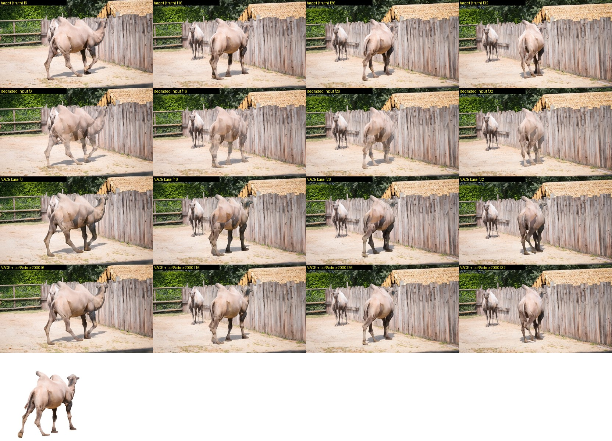
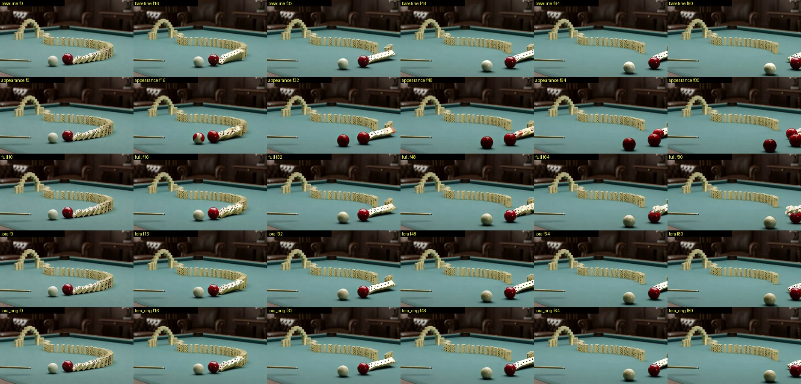
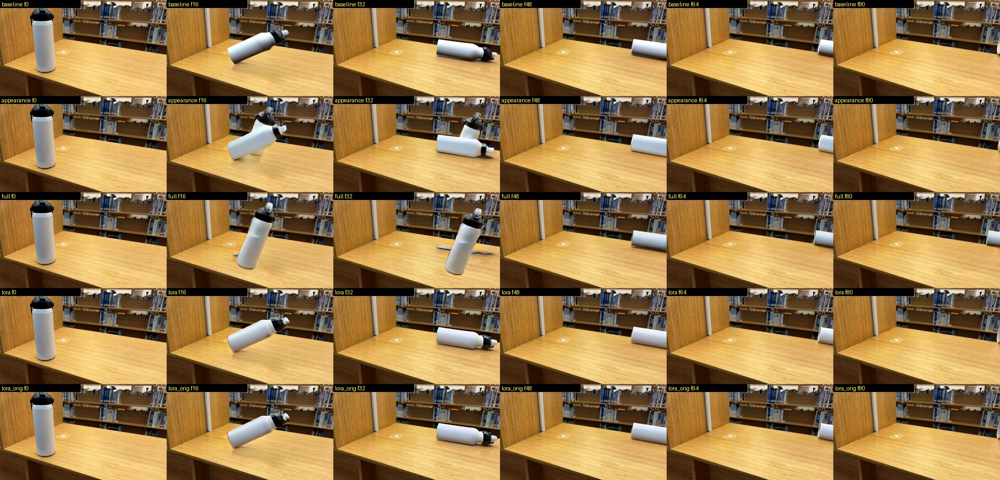
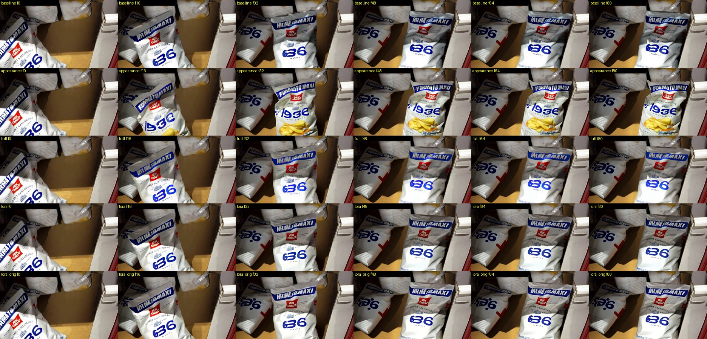

# VACE 外觀 LoRA 實驗結果 2026-11-26

計畫：`multiturn/lora_plan.md`（含完整的執行紀錄）。本報告整理結果。

## 一句話結論（初步觀察）
LoRA 學會了「**參考圖只拿外觀，不照抄姿勢和身分**」：
- 在 DAVIS 測試影片上，15 支全部比原本的 VACE 好；
- 在我們的影片上，拿掉狀態規則之後，殘影、分身、身分錯置都沒有再出現。

但它**還修不好 Goal Force「畫得清楚但畫錯」的細節**（例如洋芋片字樣被畫成「636」），所以整體外觀分數仍略低於什麼都不修的 baseline。

## 1. 做了什麼
| 項目 | 內容 |
|---|---|
| 目標 | 動作交給 Goal Force，外觀交給記憶：教 VACE 照參考圖修外觀，但姿勢和位置照輸入影片 |
| 模型 | Wan2.1-VACE-1.3B 加上 LoRA（rank 32，加在 DiT 和 VACE 分支，6,560 萬個參數） |
| 訓練資料 | DAVIS 2017 的 60 支影片自動產生：把物件弄壞（模糊、降解析度、色偏、塗灰、混入旁邊像素）；參考圖取自另一個時間點、姿勢不同的同一物件 |
| 訓練 | 3,000 步，33 格、832×480，每步約 6.1 秒，共 5.1 小時，記憶體 16 GB |
| 測試一 | 15 支沒參與訓練的 DAVIS 影片，用固定的破壞方式，比較原本的 VACE 和訓練後的版本 |
| 測試二 | 夜間實驗的 21 支第 2 回合影片，用同一支 `evaluate.py` 評分 |
| 時間 | 訓練 5.1 小時、測試一 1.6 小時、測試二 3.7 小時、追加的 `lora_orig` 2 小時，共約 12.5 小時 GPU |

## 2. 測試一：沒看過的 DAVIS 影片（15 支）
| 版本 | PSNR ↑ | R-DINO ↑ | ref_copy（≤ 0 表示沒有照抄參考圖） | 比原本好的影片數 |
|---|---|---|---|---|
| 原本的 VACE | 16.74 | 0.636 | −0.188 | — |
| LoRA 第 1000 步 | 17.58 | 0.776 | −0.060 | R-DINO 14/15 |
| LoRA 第 2000 步 | **18.44** | **0.779** | −0.065 | 15/15 |
| LoRA 第 3000 步 | 18.27 | 0.776 | −0.069 | 15/15 |

- 第 2000 步和第 3000 步幾乎一樣，大約 2000 步就收斂了。
- ref_copy 仍然是負的：LoRA 版的物件比原本的 VACE 更像參考圖（因為外觀修回來了），但沒有比正確答案本身更像參考圖，代表沒有照抄參考圖的姿勢。
- 畫面上（下圖，由上到下：正確答案、弄壞的輸入、原本的 VACE、LoRA、參考圖）：駱駝在原本的 VACE 裡留有重疊殘影、腳糊成一團；LoRA 版乾淨，腳步和姿勢都和正確答案一致。

**注意：** 兩種版本的 PSNR 都低於弄壞的輸入本身（20.47 dB），因為 VACE 會重畫整個物件區域的細節，逐像素比較對生成模型很嚴格，所以 PSNR 只拿來做相對比較。另外，計畫中的「姿勢保留 IoU」沒有做，改用 ref_copy 和目視檢查代替。

**成功標準 1：達成。**

## 3. 測試二：我們的多回合影片（21 支）
六種做法都用同一批 Goal Force 影片，所以動作完全相同，差別只在修補方式：

| 方法 | 做法 | 參考圖 |
|---|---|---|
| baseline | 不修補 | — |
| 只有外觀記憶 | 物件區域塗灰後重畫 | 原始裁切 |
| 完整方法 | 狀態規則＋保留目前像素 | 最新狀態 |
| nolora | 保留目前像素，沒有狀態規則 | 最新狀態 |
| **lora** | 同上，加 LoRA | 最新狀態 |
| **lora_orig** | 同上，加 LoRA | **原始裁切**（真正的「外觀交給記憶」） |

**結果（21 支平均）：**

| 方法 | 狀態保留 ↑ | R-DINO 對原始 ↑ | R-DINO 對最新 ↑ | 第 2 回合成功 | 消失 | 融合 | 倒退 |
|---|---|---|---|---|---|---|---|
| baseline | 0.76 | **0.608** | **0.733** | 19/21 | 3 | 25 | 3 |
| 只有外觀記憶 | 0.64 | 0.512 | 0.609 | 19/21 | 12 | 33 | 1 |
| 完整方法 | 0.77 | 0.501 | 0.612 | 19/21 | 3 | 20 | 5 |
| nolora | 0.73 | 0.539 | 0.634 | 19/21 | 3 | 26 | 4 |
| lora | 0.76 | 0.585 | 0.695 | 20/21 | 6 | 22 | 2 |
| lora_orig | 0.76 | 0.577 | 0.686 | **21/21** | 4 | 22 | **1** |

**逐支配對比較：**
- lora 對 nolora：外觀 +0.062，21 支中 15 支進步。**LoRA 本身有效。**
- lora_orig 對只有外觀記憶（**兩者用同一張原始參考圖**）：外觀 +0.072，20 支中 17 支進步；狀態保留 0.64 → 0.76。
- lora_orig 對 baseline：外觀 −0.047，只有 5/21 支比 baseline 好。**成功標準 2 沒有達成。**

**畫面上的重點（目視檢查）：**
| 例子 | 只有外觀記憶 | 完整方法 | lora／lora_orig |
|---|---|---|---|
| 骨牌 s0_A seed 0 | 白球變紅、多出一顆紅球 | 沒有錯置 | **白球維持白色**，沒有被拉回直立 |
| 水壺 | 多出直立的分身 | 先維持直立再倒下 | **沒有分身**，倒下的動作自然 |
| 咖啡 | 正常 | 留下殘影杯子 | **沒有殘影** |
| 洋芋片 | 字樣**修回**「1936」 | 字樣仍是「636」 | 字樣**仍是「636」** |

下圖由上到下：baseline、只有外觀記憶、完整方法、lora、lora_orig。第 2 列和第 5 列用的是同一張原始參考圖，只有第 5 列沒有身分錯置：

## 4. 結論與解讀
1. **「參考圖只拿外觀」這件事學會了。** 同一張原始參考圖：沒有 LoRA 時會造成身分錯置、分身、姿勢倒退；加了 LoRA 後都沒有發生。這是這次最清楚的結果。
2. **狀態規則可以拿掉。** lora 和 lora_orig 都沒有狀態規則，狀態保留卻和 baseline 一樣（0.76）、倒退次數最少（1–2 次）。完整方法造成的殘影和立著不倒的骨牌也都消失了。這支持「動作交給 Goal Force」的分工。
3. **外觀還沒有贏過 baseline。** 主要原因有兩個：
   - **LoRA 太保守**：訓練時的破壞都是「變模糊、變色」，所以它學會相信輸入裡清楚的細節。Goal Force 的走樣卻常常是「清楚但畫錯」，例如字樣變成「636」，LoRA 不會去改。
   - **修補本身有成本**：VACE 1.3B 重畫一次，細節就會比原本的 14B 輸出差一點，所以 R-DINO 很難超過什麼都不改的 baseline。
4. **Goal Force 的物理錯誤還在**（骨牌融成長板），這本來就不在 LoRA 的範圍內，要交給驗收器處理。

**證據強度：** 測試一 15 支、測試二 21 支（骨牌 12 支，照片大多 1 個 seed）。目視檢查不是盲評。以上是初步觀察。

## 5. 下一步建議
1. **補上「清楚但畫錯」的破壞類型，再訓練一輪**（約 5 小時）：例如把物件的紋理換成別的物件的紋理、打亂文字或圖案的局部區塊、把細節換成清楚但不同的圖樣。目標是讓 LoRA 學會「輸入細節和參考圖衝突時，以參考圖為準」。
2. **加入同學照片做成的 2D 動畫**，物件類型更接近我們的場景，字樣、圖案也多。
3. **只修補真的走樣的格子**：用 R-DINO 判斷外觀已經跑掉的格子才修補，其他維持 Goal Force 原樣，避免「修補本身的成本」拉低分數。
4. **驗收器**：處理骨牌融合這類物理錯誤，偵測到就換 seed 重新生成。

## 6. 檔案
- 程式：`multiturn/lora_data.py`、`lora_utils.py`、`train_vace_lora.py`、`lora_eval.py`、`lora_test2.py`；修補條件加在 `memory_repair.py`（`lora`、`nolora`、`lora_orig`）
- LoRA 權重：`outputs/lora/vace_appearance/step-{500..3000}.safetensors`（不進 git）
- 測試一：`outputs/lora/eval_davis/`（樣本、各版本影片、`scores.json`）
- 測試二：`outputs/multiturn/lora_<exp>/repair/<run>/`，包含 `{nolora,lora,lora_orig}.mp4`、`compare4.jpg`、`compare5.jpg`；評估在 `outputs/multiturn/lora_<exp>/eval/`
- 彙總：`reports/lora_assets/aggregate.md`、散佈圖 `tradeoff_vs_*.png`
- 執行紀錄、log：`multiturn/lora_plan.md`、`logs/lora/`
