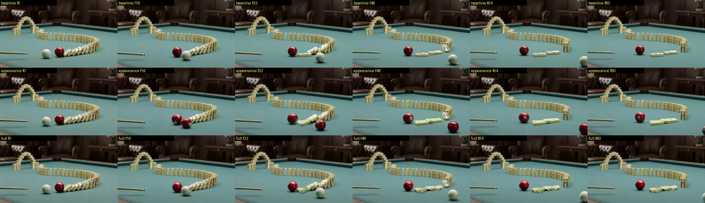
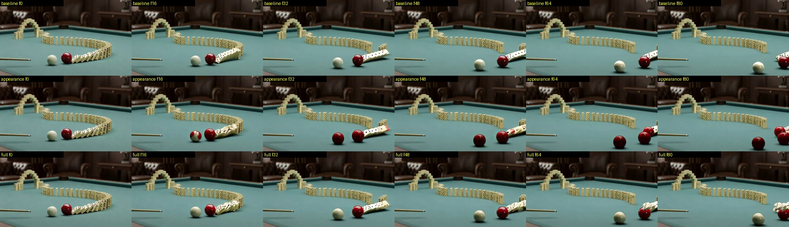
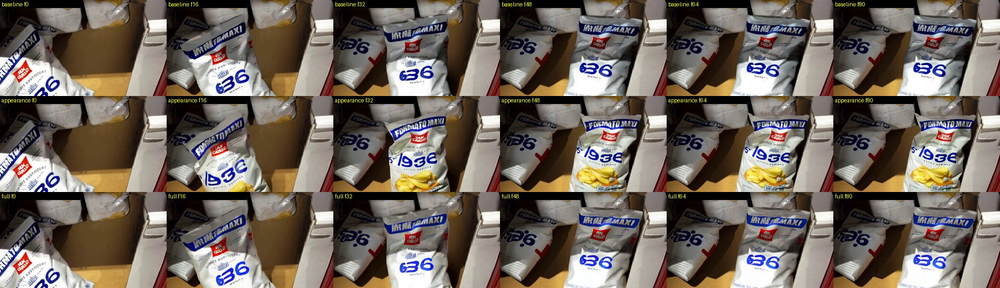
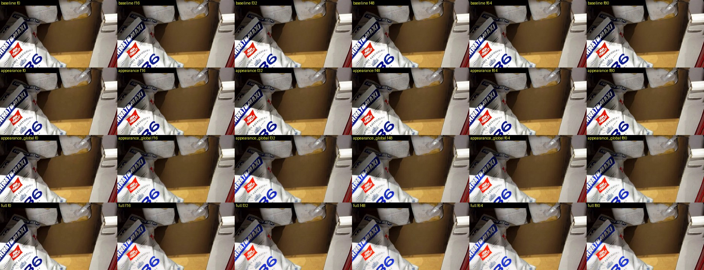
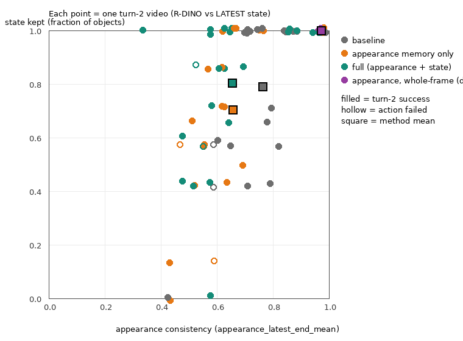
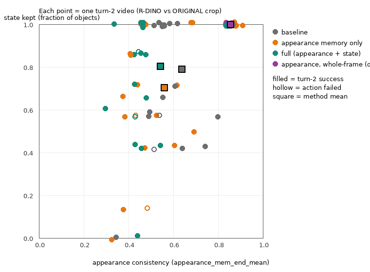

# 夜間技術紀錄 2026-11-25

> **目前進度（15:05 更新）：全部任務已完成。** GPU 時間約 14.2 小時，佇列共 33 個工作，沒有 OOM，也沒有程序崩潰。最終報告是本檔和 `reports/team_update_2026-11-25.md`。沒有 commit，也沒有 push。

研究主軸：在多回合受力互動中，影片模型會遺失物件狀態。加入外觀記憶能保住外觀，卻可能讓狀態倒退（#2 的現象）。我們把外觀和狀態分開處理，並用診斷實驗驗證。失敗案例照實記錄。

---

## 1. 完成狀態
| 任務 | 狀態 | 跑了哪些 | GPU 時間 |
|---|---|---|---|
| 0 指標與評估程式 | 完成：`multiturn/metrics.md`、`evaluate.py`、`aggregate.py`、`camera_check.py`、目視稽核 | — | — |
| 1 #6（從 seed 1 接第 2 回合）＋ #7 整理 | 完成 | 2 支 Goal Force | 44 分（佇列開始前） |
| 2 #8 記憶修補 | 完成：試跑 v1 → v2，再跑完整比較 | 新增 8 支 Goal Force（seed 1、2），沿用 4 支；試跑 2 組＋VACE 修補 24 組；共評估 36 支第 2 回合影片 | Goal Force 3 小時＋修補與評估 2.6 小時 |
| 3 新照片 | 完成：5/5 第 1 回合；5 張都跑了第 2 回合；洋芋片 3 個 seed、不施力對照組、整畫面診斷 | Goal Force 5 + 3 + 3 + 4 = 15 支；修補 33 組；評估 47 支 | 7.3 小時 |
| 4 #10 分支 | 完成：2 種推法（C 紅球往左、D 後排骨牌往右） | Goal Force 2 支＋修補 4 組 | 67 分 |
| 5 分析與相關研究 | 完成（§7、§8） | — | 只用 CPU |

工作耗時見 `logs/overnight/timings.jsonl`，各工作的 log 在 `logs/overnight/<id>.log`，佇列在 `logs/overnight/queue.txt`。
- Goal Force：每支約 22 分鐘，每個工作另加 0.5–5 分鐘載入模型。
- 修補：每支約 11 分鐘（VACE 跑兩次、每次 283 秒，加上追蹤和評估）。

## 2. 指標摘要（完整定義見 `multiturn/metrics.md`）
- **狀態保留（state kept）**：被追蹤的物件中，既沒有「遺失」也沒有「倒退」的比例。
  - **遺失**：原地消失，或融合。融合是指：≥ 3 格中和其他物件重疊超過 50%、面積縮到 0.3 倍以下，或面積變成 3 倍以上。
  - **倒退**：倒下的物件重新立起；或在沒有施力指向原位的情況下，回到距離第 1 回合初始位置一半以內。
  - 從畫面邊緣離開不算遺失。
- **起始 IoU（start IoU）**：第 1 回合最後一格和第 2 回合第 0 格的 mask IoU，用來看換回合時狀態有沒有接上。
- **外觀一致性**：R-DINO，分別和**原始**裁切（第 1 回合第 0 格）以及**最新**狀態（第 1 回合最後一格）比較。兩者都要算，因為和原始裁切比時，也會獎勵「維持原本姿勢」。
- **第 2 回合成功**：目標物件的中心位移 ≥ max(15 px, 0.25·√面積)，且和指定方向的夾角 ≤ 45°。不施力對照組則要求目標留在原地（< 15 px）。
  - 夜間新增：扣除鏡頭運動的版本（`camera_check.py`），只有在其他被追蹤物件是靜止時才有效。
- **失敗標籤**：外觀變形／狀態遺失／狀態倒退／動作失敗。
- **目視稽核**（§7）：補指標抓不到的情況，包括融成一塊、分身、身分錯置、重新立起。
- **盲評拼圖**：`outputs/multiturn/blind/<id>.jpg`，6 格、沒有任何標示。對照表是 `_key_DO_NOT_SHOW_RATERS.jsonl`。重新評估過的影片在對照表裡會重複出現，以每個 `blind_id` 的最後一行為準。

**和舊版 `eval_continuity.py` 的差異**：見 `metrics.md` 最後的表格，包括分開離開畫面與消失、融合偵測、mask IoU、目標物件的倒退判定、和最新狀態比較外觀、成功規則、stride 1。

## 3. #6／#7：骨牌融合是不是穩定出現？
#6 從**第 1 回合 seed 1 的結局**出發，跑同樣兩種第 2 回合推法：
- A：對白球直接施力，0°
- B：在倒下的骨牌 2 設目標，0°

Goal Force 用 seed 0，影片在 `outputs/multiturn/dominos_turn2_from_s1/`。

**畫面上的情況。** 兩支影片中，倒下的前排骨牌大約在第 24 格**融成一整塊長板**，和 seed 0 那條鏈一樣，並被往右推。B 裡還有一支骨牌**重新立起來**（第 36–48 格）。四支影片在第 2 回合都有鏡頭往右輕微漂移。

| 起點 | 推法 | 自動：融合物件數 | 自動：倒退 | 目視：融成一塊 | 備註 |
|---|---|---|---|---|---|
| t1 s0 → t2 | A | 4（其中 3 個也離開畫面） | 0 | 是 | 長板被推出右邊 |
| t1 s0 → t2 | B | 3（其中 3 個也離開畫面） | 0 | 是 | 一支骨牌飛起來 |
| t1 s1 → t2 | A | **0** | 0 | **是** | mask 看起來正常，只有外觀分數下降（domino3 對最新狀態的 R-DINO 0.34，domino4 0.39） |
| t1 s1 → t2 | B | 3 | 2（domino2、domino4：`changed` → `as_initial`） | 是 | 一支倒下的骨牌重新立起 |

**結論。**
- **倒下骨牌的融合在 4/4 支 seed 0 影片都出現**，涵蓋兩種第 1 回合結局和兩種推法。在這個場景裡，這是 baseline 穩定的失敗，不是某個 seed 的偶然。
- seed 1 還出現第二種狀態失敗：**倒退**（倒下的骨牌重新立起）。
- **樣本說明**：這裡只有一個場景、Goal Force seed 0。下面 #8 的 seed 1、2 把樣本擴充到 12 支。

**指標上的教訓（在 #8 開跑前修正）。** s1→A 那支影片的長板沒有反映在 mask 上：SAM2 在長板上替每支骨牌都留了一個看起來合理的 mask，融合只表現為外觀分數下降。因此做了兩件事：
1. `appearance_deformed`（和最新狀態比的 R-DINO < 0.5）是能抓到它的自動訊號。
2. 加上**目視稽核**欄位，規則明確（§7）：
   - **融合**：第 2 回合第 0 格還分開的物件，在 ≥ 2 張關鍵幀中變成一個連續的整體。
   - **分身**：同一個物件出現兩次。

   例如 s0→A 的 seed 2 從第 32 格起出現**兩顆紅球**，沒有任何自動指標標出來。

這幾支影片的舊版 `eval_continuity.py` 數字在 `outputs/multiturn/dominos/eval_t2*_from_s1.json`，新版在 `outputs/multiturn/exp8/eval/baseline/`。

## 4. #8：baseline vs 只有外觀記憶 vs 完整方法
設計見 `multiturn/memory_plan.md`，檔案最後記錄了試跑過程，包括 v1 改成 v2 的原因。

### 4.0 試跑（t1 s0 → A，Goal Force seed 0）
| 版本 | 發生了什麼 | 判定 |
|---|---|---|
| 只有外觀記憶（v1、v2 相同） | 從第 16 格起，**白球被畫成紅球**：多物件的參考圖讓身分混淆。v1 裡倒下的骨牌也被拉回直立。 | 重現了 #2 的倒退，並多了一種新失敗：身分錯置 |
| 完整方法 v1（固定在原地） | 沒有骨牌離開畫面，但被固定的碎片正好在紅球推骨牌堆的路徑上，VACE 把它們畫成**浮在空中、直立的碎片**（3 個 `as_initial`） | 沒通過試跑標準 → 修改規則 |
| 完整方法 v2（剛體跟隨） | 骨牌維持**一片片分開**，跟著骨牌堆往右移（第 32–48 格）。沒有長板，也沒有離開畫面。1 支骨牌被標成 `as_initial`。 | 通過 → 開始完整比較 |

試跑的對照圖：`outputs/multiturn/exp8/repair/s0_A_seed0/compare.jpg`（v1 在 `outputs/multiturn/exp8/pilot_v1/repair_s0_A_seed0/compare.jpg`）。

**數字上的注意事項。** 完整方法的信任規則用「和最新狀態的 R-DINO < 0.5」，和評估程式的 `appearance_deformed` 門檻相同。修補後的影片會從頭重新追蹤、重新評分，所以不是循環論證，但這個指標比較接近完整方法本身在最佳化的東西。

實際上，試跑時自動標籤**沒有**偏袒完整方法：它還是被標成 `appearance_deformed` 加 `state_lost`，因為被推動、轉動的骨牌和第 1 回合的裁切長得不同。畫面上完整方法讓碎片保持分開，但指標分不出「轉動」和「融合」。這部分真正要靠盲評檢驗。

### 4.1 完整比較
範圍：2 種第 1 回合結局（s0、s1）× 2 種推法（A 直接推白球、B 在骨牌 2 設目標）× Goal Force seed 0/1/2，共 **12 支 Goal Force 影片**。每支用 3 種條件評分，共 **36 支第 2 回合影片**，全部用同一支 `evaluate.py` 評分。數值是 12 支的平均 ± 標準差，各支原始數值在 `reports/overnight_assets/aggregate.md`。

| 方法 | 狀態保留 ↑ | R-DINO 對原始 ↑ | R-DINO 對最新 ↑ | 第 2 回合成功 | 消失物件數 | 融合物件數 | 離開畫面 | 狀態遺失的影片 | 狀態倒退的影片 |
|---|---|---|---|---|---|---|---|---|---|
| baseline | 0.73 ± 0.25 | **0.59 ± 0.09** | **0.71 ± 0.08** | 10/12 | 2 | 22 | 9 | 7/12 | 2/12 |
| 只有外觀記憶 | 0.58 ± 0.27 | 0.47 ± 0.08 | 0.57 ± 0.07 | 10/12 | **10** | 27 | 4 | 11/12 | 1/12 |
| 完整方法（外觀＋狀態） | **0.77 ± 0.25** | 0.46 ± 0.03 | 0.57 ± 0.05 | 10/12 | 2 | **17** | 1 | **5/12** | 3/12 |

- `appearance_deformed` 在 **36 支全部**觸發：被推動、轉動的骨牌和第 1 回合裁切比，一定低於 0.5。在這個門檻下，它分不出方法的差異，所以列出但不拿來下結論。
- 第 2 回合失敗的都是同幾支 Goal Force 影片：baseline 和完整方法失敗在 s0_B 的 seed 1、2，只有外觀記憶失敗在 s0_B seed 2 和 s1_B seed 0。所以**修補不會改變推動有沒有成功**。
- 逐支配對，完整方法減 baseline 的狀態保留差：
  - s0_B seed 1 +0.29、s0_B seed 2 +0.14、s1_B seed 0 +0.43；
  - s0_A seed 2 −0.14、s0_B seed 0 −0.14；
  - 其他 7 支是 0。

  **進步來自 12 支中的 3 支。** 其中進步最大的 s1_B seed 0（+0.43）在**畫面上看不出差別**：對照圖裡長板和直立的骨牌都和 baseline 一樣，是指標把被固定的碎片算成「保留」了。

**目視稽核**（由我評、不是盲評；規則見 `reports/overnight_assets/visual_audit.md`）。12 支影片的計數，括號內是「部分」：

| 方法 | 融成一塊 | 分身 | 身分錯置 | 倒下又立起 | 其他異常 |
|---|---|---|---|---|---|
| baseline | 8（+1） | 1 | 0 | 2（+1） | 3 |
| 只有外觀記憶 | 8（+1） | **5** | **11** | 1（+1） | 2 |
| 完整方法 | **6（+3）** | 1 | 0 | 1（+2） | **5（+2）** |

### 4.2 代表的意義
1. **只有外觀記憶時，兩個面向都變差。**
   - 12 支中有 11 支的**白球被畫成紅球**：多物件參考圖把一個物件的外觀套到另一個物件上，接著就出現分身（5/12）。
   - 這是比 #2 更嚴重的倒退：記憶覆寫的是**身分**，不只是姿勢。
   - 它的外觀分數也比 baseline 低，所以這裡的外觀記憶連外觀都沒換到。
2. **完整方法是在 trade-off 上移動，沒有跳脫它。**
   - 狀態略好：狀態保留 0.73 → 0.77、融合物件 22 → 17、有狀態遺失的影片 7 → 5、被推出畫面 9 → 1、明顯融成一塊的 8 → 6 支。
   - 外觀比 baseline 差：和最新狀態的 R-DINO 0.71 → 0.57，修補造成的異常 3 → 5。
   - 外觀變差的原因是較弱的 VACE 1.3B 重畫，加上貼上的碎片，不是記憶本身：完整方法從來沒有身分錯置（0/12）。
3. **把外觀和狀態分開，是身分錯置消失的原因**（11 → 0）。這是整個實驗中最清楚的效果。
4. **融合大多沒辦法事後修好。** 被固定或跟隨的只有追蹤中的 4 支骨牌，但長板裡還有約 4–6 支**沒被追蹤**的倒下骨牌，而 Goal Force 會把整塊長板一起推走。12 支中有 6 支，完整方法仍然看得到長板。

**證據強度。**
- 只有一個場景、12 支 Goal Force 影片，VACE seed 固定為 0。
- 標準差很大（狀態保留 ±0.25），配對比較的進步只來自 3 支。
- 所以這些是**初步觀察**，不是證明有改善。只有身分錯置（11/12 vs 0/12）的差距相對樣本數夠大。

每支 Goal Force 影片都有一張並排對照圖（baseline／外觀／完整，第 0–80 格）：
- 對照圖：`reports/overnight_assets/exp8/<起點>_<推法>_seed<k>_compare.jpg`
- 修補後影片：`outputs/multiturn/exp8/repair/<run>/{appearance,full}.mp4`
- baseline：`outputs/multiturn/dominos_turn2*/` 和 `outputs/multiturn/exp8/gf_from_s*/`

### 4.3 #10 分支（從第 1 回合 seed 0 的結局出發，換一種第 2 回合推法；Goal Force seed 0）
箭頭預覽在 `datasets/multiturn/dominos/t2{C,D}_*_preview.png`。

| 分支 | 推法 | 規則判定 | baseline | 只有外觀記憶 | 完整方法 |
|---|---|---|---|---|---|
| C | 紅球往左（直接施力，180°，200） | 全部 ✔（往左 402 px） | 紅球滾回去、經過白球；**沒被碰到的倒下骨牌維持一片片倒著**（狀態保留 1.00） | 白球變紅，出現兩顆紅球 | ≈ baseline（有 1 個自動倒退標籤） |
| D | 後排立著的骨牌往右（直接施力，0°，150） | 全部 ✔ | 後排骨牌連鎖往右倒；前面那堆沒被碰到（狀態保留 1.00） | ≈ baseline | 倒下的那排裡**有一支骨牌一直立著** |

**重點。**
- 同一個第 1 回合結局可以用不同推法做分支，對應 demo 裡「回到過去、改走另一條路」。
- 第 2 回合的動作**沒碰到倒下的骨牌堆**時，baseline 能完整保住它，沒有融合。所以融合是推動骨牌堆造成的，不是換回合造成的。
- 在 baseline 本身就乾淨的情況下，完整方法只會多出錯誤（D 裡那支直立的骨牌）。

對照圖：`reports/overnight_assets/exp8/branch_{C,D}_compare.jpg`。

## 5. 洋芋片診斷：物件回到原位，是施力造成的，還是記憶拉回去的？
**設定。**
- 第 1 回合：前面那包 FORMATO MAXI 被**往左**推，離原位 377 px（成功）。
- 第 2 回合從第 1 回合結局出發，分兩種情況：
  - **施力**：直接推袋子**往右**（往原位的方向），力道 200；
  - **不施力對照組**：Goal Force 的控制訊號**全部歸零**（已確認控制影片最大值為 0）。
- 每種情況用 Goal Force seed 0/1/2，每支影片再做 baseline／只有外觀記憶／完整方法。
- 只有外觀記憶時，VACE 參考圖把原始袋子的裁切**放在它的原位**，這是最強的「拉回」提示。

**量什麼。** 第 2 回合結束時，袋子中心離第 1 回合初始位置的距離（第 2 回合開始時是 377 px），以及目標的位移量。

| 情況 | 方法 | seed 0 | seed 1 | seed 2 | 移動量（px） | 有沒有往原位回去？ |
|---|---|---|---|---|---|---|
| 施力 | baseline | 94 | 33 | 75 | 285–338 | 有，**是施力造成的**（3 種方法相同） |
| 施力 | 只有外觀記憶 | 100 | 31 | 71 | 281–346 | 有，和 baseline 相同 |
| 施力 | 完整方法 | 94 | 32 | 76 | 286–339 | 有，和 baseline 相同 |
| 不施力 | baseline | 377 | 378 | 378 | 0–1 | **沒有** |
| 不施力 | 只有外觀記憶 | 376 | 377 | 377 | 1–2 | **沒有** |
| 不施力 | 完整方法 | 377 | 378 | 378 | 0–1 | **沒有** |
| 不施力 | 只有外觀記憶，**整畫面** mask（診斷用） | 378 | 378 | 378 | 0–1 | **沒有** |

（seed 0/1/2 欄是第 2 回合結束時離原位的距離，單位 px。）

**答案。**
1. **回到原位是施力造成的，不是記憶。**
   - 有施力時，同一個 Goal Force seed 下，每種方法停的位置都相同（±6 px），修補從來沒有移動過袋子。
   - 不施力時，沒有任何一支回去：有 mask 的修補 9/9，整畫面修補 3/3。
   - 第 2 回合成功（袋子往右移動達門檻、夾角 45° 內）每種方法都是 3/3；對照組「留在原地」每種方法也都是 3/3。
2. **為什麼有 mask 的修補在設計上就拉不回來。**
   - 修改範圍只包含物件目前的區域加上邊界，原位在 377 px 外，不在範圍內。
   - 所以我另外加了**整畫面**版本：第 4 格之後整個畫面都可以重畫，參考圖把袋子放在原位。
   - 結果 VACE 還是把袋子留在來源影片裡的位置。在這套流程中，**位置由來源影片主導**，參考圖只會改變外觀。
3. **#2、#8 裡的「拉回」實際上從哪來。** 它出現在物件區域被**塗成灰色**、只能靠參考圖填回的時候。這時參考圖決定了 mask 裡的**姿勢和身分**：
   - 滾動的達摩坐正（#2）；
   - 倒下的骨牌立起；
   - 白球變紅（#8）。

   所以記憶造成的狀態倒退，發生在**姿勢和身分**層面，不在**位置**。
4. **單一物件 vs 多物件。**
   - 洋芋片只有一個物件時，外觀記憶明顯**修回**了包裝字樣：seed 0、1 是「1936」，baseline 則壞成「66」、「636」。
   - 骨牌有 7 個物件時，外觀記憶反而**錯置**了身分。效果取決於參考圖裡有多少相似物件。
   - R-DINO **沒有**反映出字樣被修回：只有外觀記憶的 seed 1、2 是 0.68，baseline 是 0.86–0.87。這個指標對文字是否清楚不敏感，盲評時應該納入。

**限制。**
- 只有一個場景、3 個 seed、單一物件，而且只做了事後修補。
- 如果記憶是**在生成過程中**注入（像 HECTOR 或 WorldMem），仍然可能把位置拉回；這個實驗無法排除。

對照圖：`reports/overnight_assets/chips/forced_seed<k>_compare.jpg`（baseline／外觀／完整）和 `noforce_seed<k>_compare4.jpg`（baseline／外觀／整畫面／完整）。

## 6. 新照片
輸入：裁切、施力和物件點選位置都在 `multiturn/photo_scenes.json`，預覽圖在 `datasets/multiturn/<場景>/`。server 上**只有 5 張照片，沒有第六張**。第 1 回合用 Goal Force seed 0，每支約 23 分鐘。

### 6.1 裁切與調整（改了什麼、為什麼）
| 場景 | 照片 | 裁切／調整 | 施力（第 1 回合） |
|---|---|---|---|
| chips（洋芋片） | IMG_3886（直拍） | 取全寬的橫向帶 y 1075–2446。FORMATO MAXI 那包約 1400 px，剛好放得下，頂角可能少幾 px。 | 直接施力，前面那包，180°（往左），200 |
| coffee（咖啡） | IMG_8550（直拍） | 取 y 1500–3245，保留完整的**馬克杯**（主物件）。後面的冰飲只剩下半部，杯蓋和吸管被裁掉，因為橫向裁切放不下兩個。 | 直接施力，馬克杯，90°（往後＝畫面往上），200 |
| bottle（水壺） | IMG_9246 | 全寬。照你的要求，手留在畫面裡，是場景的一部分。 | 直接施力，水壺，180°，200（施力在水壺上，不在手上） |
| books_pull（書架抽書） | IMG_9247 | 全寬。手上那本書約 3490 px 高，橫向帶只有 3295 px，所以上下各裁掉約 100 px。 | 直接施力，手上的書，90°（推進書架＝往上、往裡），200 |
| books_push（書架推書） | IMG_9251 | 手指**無法**在不切到米色書的情況下裁掉（書在 4284 px 高的照片裡佔 y 1080–3850），所以手留著，當作靜止背景、不施力 | 直接施力，米色書，0°，**250**。比較強，因為要推倒一本厚書。 |

**力道。** 我用 200（厚書用 250），沒有用官方的 350，因為 pilot 顯示 350 對實拍照片太強。

### 6.2 第 1 回合結果
| 場景 | 規則（絕對位移） | 規則（扣除鏡頭運動） | 目視 | 發生了什麼 |
|---|---|---|---|---|
| chips | ✔（往左 368 px） | 無法計算（沒有靜止的參考物件） | ✔ | 前面那包往左滑並傾斜。左邊那包被它擋住（81 格中只追蹤到 73 格）。後面的袋子有輕微移動（鏡頭運動）。 |
| coffee | ✔（往上 104 px） | 無法計算（只有 1 個參考物件） | ~ | 馬克杯相對於飲料杯往後移，但**鏡頭也在動**，而且**咖啡從奶咖啡變成黑咖啡**（內容物的外觀改變）。 |
| bottle | ✔（往左 238 px） | 無法計算 | ~ | 水壺往左滑，但**手放開後離開畫面**，沒有跟著移動。第 16–48 格**多出一個黑色瓶蓋狀的物件**，瓶蓋形狀也變了。 |
| books_pull | ✘（89 px，和「往上」夾角 62°） | ✘ | **✔** | 手把書推回書架後收回。第 64 格書架上多出一張白色標籤。2D 規則**量不到景深方向的運動**：「推進書架」在畫面上只是往左上小幅移動加上縮小（面積 ×0.23）。 |
| books_push | ✔（往右 164 px） | **✘**（鏡頭平移：所有書都移了約 130 px，相對位移 34 px，門檻是 51） | ✘ | **沒有任何書倒下。** 米色書轉向鏡頭，右邊的書被擠扁（白色書面積 ×0.16）。是鏡頭平移讓絕對規則誤判為成功。 |

只要規則或目視其中一個判定成功，就跑第 2 回合，所以 5 張都跑了，兩種判定都列出。books_pull 的規則判定是失敗，但畫面上明顯成功，所以仍跑了第 2 回合，請當作探索性結果。

**規則的新問題（鏡頭運動）。** 目標位移規則是在畫面座標下量的，鏡頭平移時所有物件都會「移動」，books_push 就因此被誤判為成功。現在 `multiturn/camera_check.py` 會另外算扣除鏡頭運動的版本：目標位移減掉其他被追蹤物件位移的中位數，需要至少 2 個其他物件。§7 的所有第 2 回合評估都套用了它。

第 1 回合畫面：`reports/overnight_assets/photos/<場景>_t1_strip.jpg`；預覽圖 `_t1_preview.png`；追蹤疊圖 `_t1_overlay.png`。

### 6.3 第 2 回合（從各自的第 1 回合結局出發，Goal Force seed 0；洋芋片 3 個 seed，見 §5）
| 場景 | 第 2 回合推法（除非你有指定，否則是我選的） | 規則（絕對） | 扣除鏡頭 | baseline | 只有外觀記憶 | 完整方法 |
|---|---|---|---|---|---|---|
| chips | 前面那包 → 往右，200（你指定的） | 每種方法 3/3 | 無法計算 | 袋子回去，字樣損壞 | 動作相同，**字樣被修回** | ≈ baseline |
| coffee | 馬克杯 → 往左，180°，200 | 全部 ✔ | 無法計算 | 杯子往左滑出畫面 | ≈ baseline | **左邊留下殘影杯子**（跟隨規則把該離開的物件留下來了） |
| bottle | 水壺 → 往右，0°，200 | 全部 ✔ | 無法計算 | 倒下後往右滾出畫面 | **兩個水壺**（參考圖的直立分身＋正在倒下的那個） | 維持直立比較久，之後才倒下 |
| books_pull | 旁邊的書（`book_rail_up`）→ 往左，150 | 全部 ✔ | ✘（需要 ≥ 2 個靜止參考物件，判定不明確） | 被推的書往左倒、靠在旁邊的書上；**第 1 回合放回去的書維持在架上** | ≈ baseline | ≈ baseline |
| books_push | 米色書 → 再往右，250 | 全部 ✔（往右下掉，和「往右」夾角 41°） | ✔ | 米色書**從書架掉下去**；它右邊的書**原地消失** | 相同 | 相同 |

**觀察（初步：每個場景 1 個 seed）。**
- **外觀記憶的兩面再次出現。**
  - 單一物件時，它能修回外觀（洋芋片字樣）。
  - 物件的姿勢應該要改變時，原始姿勢的參考圖會**多出一個直立分身**（水壺）。這是整晚最清楚的「外觀記憶 → 狀態倒退」單一例子。
- **完整方法的狀態約束在兩個方向都可能出錯。**
  - 它會留住該離開的物件（咖啡的殘影杯子）。
  - 它救不回 Goal Force 已經刪掉的物件（books_push 消失的書、骨牌長板）。
- **books_push 第 2 回合的狀態遺失**（旁邊的書消失），對應到骨牌的融合：兩者都是被推動的物件撞到的東西失去身分或直接消失。第 1 回合沒有書像骨牌一樣倒下，所以你要的「骨牌 vs 書」比較只適用於這個第 2 回合的現象。
- **手。**
  - bottle：第 1 回合手沒有跟著水壺移動，而是放開後離開。
  - books_pull：手確實完成了放回書架的動作，然後離開。
  - books_push：手指是靜止背景，後來因鏡頭平移離開畫面。

  Goal Force 沒有「手是施力者」的概念，只把手當成可能移動或離開的場景內容。
- **景深方向的運動（books_pull vs 保齡球）。** 把書放回書架在畫面上是成功的，保齡球則沒有，但 2D 規則量不到前者。差別在於：書只是往手旁邊的空位推進一小段，保齡球要往畫面深處滾很遠並撞倒很多瓶。這只是一個例子，不是結論。

對照圖（baseline／外觀／完整）：`reports/overnight_assets/photos/<場景>_t2_compare.jpg`；箭頭預覽 `<場景>_t2_preview.png`。

## 7. trade-off 散佈圖與失敗分類
所有自動評估數字見 `reports/overnight_assets/aggregate.md`（依場景×方法、合計、逐支）和 `aggregate.json`。

**24 支第 2 回合 Goal Force 影片合計。**
- 組成：骨牌 12、分支 2、洋芋片施力 3、洋芋片不施力 3，以及咖啡、水壺、書架抽書、書架推書各 1。
- 每支影片用 3 種方法評分；3 支整畫面診斷另外列。

| 方法 | 狀態保留 ↑ | R-DINO 對原始 ↑ | R-DINO 對最新 ↑ | 第 2 回合成功* | 消失物件 | 融合物件 | 倒退物件 |
|---|---|---|---|---|---|---|---|
| baseline | 0.79 | **0.64** | **0.76** | 22/24 | 3 | 25 | 3 |
| 只有外觀記憶 | 0.68 | 0.56 | 0.66 | 22/24 | 12 | 33 | 1 |
| 完整方法 | **0.80** | 0.54 | 0.66 | 22/24 | 3 | **20** | 5 |

\* 3 支不施力對照組的「成功」是指袋子留在原地。

**怎麼看散佈圖。** 每個點是一支第 2 回合影片：x 是結束時可見物件的平均 R-DINO，y 是狀態保留；方塊是各方法的平均。
- **只有外觀記憶**落在 baseline 的**左下方**：兩個面向都比較差。
- **完整方法**的狀態保留和 baseline 差不多或略高（合計 0.80 vs 0.79；骨牌 0.77 vs 0.73），但外觀落在 baseline **左邊**（0.66 vs 0.76）。

所以完整方法是**沿著 trade-off 曲線移動**：狀態多一點，外觀明顯少一些，沒有兩邊同時改善。外觀的損失主要來自 VACE 1.3B 重畫本身（色斑、碎裂；洋芋片的字樣也沒有比 baseline 好），不是身分錯置，完整方法從沒發生過身分錯置。

**失敗分類。**

*自動標籤*（可重疊；每種方法 24 支）：

| 方法 | 外觀變形 | 狀態遺失 | 狀態倒退 | 動作失敗 | 沒有失敗 |
|---|---|---|---|---|---|
| baseline | 15 | 10 | 2 | 2 | 8 |
| 只有外觀記憶 | 15 | **15** | 1 | 2 | 7 |
| 完整方法 | 15 | **8** | 5 | 2 | 6 |

*目視稽核*（由我評、不是盲評；計 Y，括號內是部分；逐支紀錄在 `overnight_assets/visual_audit.md`）：

| 方法 | 外觀變形（身分錯置、字樣或顏色損壞、碎裂） | 狀態遺失（融成一塊、數量減少、分身、旁邊物件消失） | 狀態倒退（重新立起、直立分身、殘影） | 動作失敗（規則） |
|---|---|---|---|---|
| baseline | 3（+1） | 10（+1） | 2（+1） | 2 |
| 只有外觀記憶 | **12**（骨牌 11 次錯置＋分支 C 1 次） | **14**（+1） | 2（+1） | 2 |
| 完整方法 | 6（+2） | **8**（+3） | 3（+3） | 2 |

**各方法失敗在哪裡。**
- **只有外觀記憶**：身分（撞球桌 14 支中 12 支白球變紅）和分身（直立的水壺分身）。這正是我們要研究的倒退，而且範圍比「姿勢」更廣。
- **完整方法**：
  - 狀態遺失比較少（融合物件 25 → 20；骨牌融成一塊 8 → 6）；
  - 但狀態倒退或殘留比較多（自動倒退 5 次 vs 3 次；咖啡殘影杯子、分支 D 立著的骨牌）；
  - 修補異常也比較多。

  它的狀態規則是啟發式的，兩個方向都會出錯：留住應該離開或倒下的物件，又救不回 Goal Force 已經刪掉的物件。
- **baseline** 最主要的失敗是**推動一堆相似物件時**的狀態遺失（融成一塊或數量減少）。分支 C 沒碰到倒下的骨牌堆，就完全沒有融合。

**證據強度。**
- 骨牌：12 支。
- 照片：每個場景 1 個 seed，洋芋片 3 個。
- 目視稽核不是盲評。

以上都是**初步觀察**。只有兩項效果夠大、夠一致，可以比較肯定地說：
- 身分錯置：只有外觀記憶 12 次，其他方法 0 次。
- 「回到原位是施力造成，不是記憶造成」：洋芋片施力的 9 支，三種方法回到的位置相同；不施力的 12 支，沒有任何一支回去。

## 8. 相關研究與為什麼採用 training-free

### 8.1 相關研究
標題、作者、年份和發表處都用 OpenAlex（research-desk reference lookup）核對過。內容描述來自網路搜尋找到的摘要和專案頁（連結在下方）。我**沒有讀過全文**，需要細節才能判斷的地方標為「待確認」。

| 研究 | 處理什麼問題 | 記住什麼、怎麼記 | 和我們的差別 |
|---|---|---|---|
| **WorldMem**（Xiao et al., NeurIPS 2025） | 長期一致的世界模擬；重訪場景（Minecraft、RealEstate10K） | 記憶庫裡每個單元存一張過去的影格和它的狀態（相機姿態、時間戳）；用目前影格當 query 做 memory attention；依視野重疊檢索。時間戳讓它能建模世界隨時間的變化。 | 記憶以**相機視角和時間**為索引，需要訓練。我們以**物件**為索引，變化來自**施力**。WorldMem 有沒有測試施力造成的物件狀態變化（Minecraft 互動以外），待確認。 |
| **Context as Memory**（Yu et al., SIGGRAPH Asia 2025） | 場景一致的互動長影片；鏡頭回到同一處時重現同樣畫面 | 把過去影格當作 context（影格串接）；依相機視野重疊檢索相關影格 | 針對**鏡頭移動和重訪場景**，大多是靜態場景，需要訓練。我們針對**被推動而改變狀態的物件**。 |
| **VMem**（Li et al., ICCV 2025） | 一致的互動場景生成 | 以 surfel 為索引的視角記憶：透過 3D surfel 檢索過去的視角 | 以 **3D 幾何和視角**為索引，靜態場景，沒有逐物件的物理狀態。 |
| **RELIC**（Hong et al., arXiv 2025） | 從單張圖做即時、長時間的互動探索（14B，16 FPS） | 精簡、感知相機的記憶，以 3D 一致的方式檢索內容；用長 context 蒸餾訓練 | 探索用的記憶（相機），用 Unreal Engine 資料訓練。是否處理物件動態，待確認。 |
| **MotionStream**（Shin et al., ICLR 2026） | 即時串流影片，可互動控制運動（軌跡） | 有限 context 的串流自回歸生成（細節待確認） | 在**同一條串流內**持續互動，用軌跡控制。我們是把**分開的施力回合**串起來，中間有明確的物件記憶。 |
| **WonderPlay**（Li et al., ICCV 2025） | 從單張圖加動作生成動態 3D 場景 | 混合式生成模擬器：物理求解器加影片生成器，修正 3D 場景表示 | 明確的 **3D 和物理狀態**，每個場景要重建。我們停留在 2D 影片，且 training-free。 |
| **PerpetualWonder**（Zhan et al., CVPR 2026） | 長時間、由動作驅動的 4D 場景 | 統一的表示法，雙向連結物理狀態和視覺元素：先用物理做前向推演，再依影片模型的修正做反向最佳化。非即時。 | 精神上最接近，因為它主張**外觀的修正必須回饋到狀態**。它用的是明確的 4D 和物理場景，我們則不做重建、低成本地測試同樣的外觀／狀態分離。 |
| **RealWonder**（Liu et al., arXiv 2026） | 即時、由動作驅動的影片（力、力矩、機器人、相機） | 3D 重建 → 物理模擬 → 蒸餾過、以 flow 為條件的影片生成器（H200 上 13.2 FPS） | 狀態存在**模擬器**裡。我們的狀態存在 **2D 物件記憶**裡，建立在學出來的施力模型（Goal Force）上。 |
| **Force Prompting**（Gillman et al., NeurIPS 2025）、**Goal Force**（Gillman et al., arXiv 2026） | 用力或目標力控制影片模型，以合成物理資料訓練 | 沒有記憶：一張圖＋一個力 → 一支影片 | 我們的基礎模型。我們在它外面加上多回合設定和物件狀態記憶。 |
| **HECTOR**（ICML 2026，arXiv 2603.08850） | 參考物件的外觀與軌跡控制 | 把參考物件的 VAE latent 沿軌跡 warp（STAM）；需要訓練 | 我們的外觀記憶沿用它的參考圖概念（以及 R-DINO 指標）。HECTOR 會保留**參考圖的姿勢**，這正是我們看到的倒退（#2）。 |

另外找到但沒有細看：Mixture of Contexts（ICLR 2026）、Context Forcing（ICML 2026）、Infinite-World（arXiv 2026）、Matrix-Game 3.0（arXiv 2026）、DecMem（arXiv 2026）。從標題看都是相機／世界探索型的記憶，待確認。

**我們的定位（暫定）。** 就目前找到的研究來看：
- 記憶相關研究大多以**相機**為中心（視野重疊、surfel、相機姿態），問的是「再看一次時，場景還一樣嗎」。
- 物理相關研究則把狀態放在明確的 **3D 或模擬場景**裡。

我們的空缺在兩者之間：以**物件為單位、2D、training-free** 的記憶，並診斷**施力互動之後，外觀記憶和狀態不一致時會發生什麼**。這個定位只根據摘要，不是完整的文獻回顧，引用前請先確認標「待確認」的部分。

來源：[WorldMem arXiv](https://arxiv.org/abs/2504.12369) · [Context as Memory DOI](https://doi.org/10.1145/3757377.3763833) · [VMem DOI](https://doi.org/10.1109/iccv51701.2025.02383) · [RELIC arXiv](https://arxiv.org/abs/2512.04040) · [MotionStream](https://proceedings.iclr.cc/paper_files/paper/2026/hash/0cece806cd3d1dfad4a893f016ad3d7d-Abstract-Conference.html) · [WonderPlay DOI](https://doi.org/10.1109/iccv51701.2025.00849) · [PerpetualWonder arXiv](https://arxiv.org/abs/2602.04876) · [RealWonder arXiv](https://arxiv.org/abs/2603.05449) · [Force Prompting DOI](https://doi.org/10.52202/085713-3448) · [Goal Force arXiv](http://arxiv.org/abs/2601.05848)

### 8.2 為什麼採用 training-free（推論時修補）
**原因。**
1. **算力。** Goal Force 本身是用 4 張 80 GB GPU 訓練的，我們只有一張 32 GB 的卡；HECTOR 那類參考控制用了 64 張 GPU。
2. **資料。** 目前沒有多回合施力的資料集，要自己做（帶物件身分的 Blender 多回合場景）本身就是另一個專案。
3. **先診斷。** 生成後才修補，可以把 Goal Force 的動作**固定住**，只改變記憶提供的內容，這樣才能單獨回答外觀 vs 狀態的問題。重新訓練的模型會同時改變所有東西。
4. **模組化。** 同一套記憶可以接在任何 I2V／施力模型後面。

**限制。**
- 只能**重畫 Goal Force 已經生成的內容**。如果動態本身是錯的（融成長板被推出畫面），修補只能藏起碎片或把它們固定住，生不出物理上正確的動作。
- 固定一個沒被追蹤到的物件，等於假設它沒動；如果它其實被推了，就會出錯。
- 修補模型（VACE 1.3B）比生成模型（14B）弱，會有色偏和殘影（#2 已經看過）。
- 一切都依賴 SAM2 的追蹤結果。
- 每支影片多花約 5 分鐘。

如果診斷結果能指出記憶應該從哪裡介入，下一步自然是訓練版本：在 Goal Force 內部加入記憶 token 或參考 latent，像 HECTOR 或 WorldMem 那樣。

## 9. 錯誤與修正
- **00:35，重啟佇列。** 我停止並重啟佇列時，`pkill -f "logs/overnight/runner.sh"` 比對到自己這個 shell 的指令列，把自己也停掉了。這和記憶裡記過的是同一個坑（`pgrep -f` 比對到自己）。沒有造成損失：之後用 PID 停掉舊的 Goal Force 程序，再重新啟動佇列。從此只用 `touch logs/overnight/STOP` 或 `logs/overnight/runner.pid` 裡的 PID 來停止排程器。
- **00:35，刪除被擋下。** 想 `rm` 掉做到一半的 `outputs/multiturn/exp8`，被安全檢查擋下。其實不需要刪（Goal Force 會跳過已完成的輸出），所以**什麼都沒刪**。`outputs/multiturn/exp8/gf_from_s0/` 裡留著第一次中斷時產生的幾個控制訊號檔，不影響結果。
- **01:24，工作被誤判為失敗。** `eval8_base_test` 被標成失敗（rc=1），但評估本身其實都成功了。原因是腳本最後一行對還不存在的 seed 執行了 `[ -n "" ] && …`，回傳了非零值。已加上 `exit 0` 修正，之後完整跑的 `eval8_base_all` 順利通過。
- **01:25，評估程式看不到融合。** SAM2 在融合的長板上仍保留看起來合理的 mask。所以加入了：逐格和最新狀態比較的 R-DINO（存在 `eval.json` 的 `series`）、目視稽核，以及完整方法信任判定中的外觀規則。這些都在 #8 完整比較**之前**改好，見 `memory_plan.md`。
- **01:36，試跑 v1 沒通過自己的標準。** 被固定的骨牌被畫成浮在空中的直立碎片。在完整比較前改成剛體跟隨（v2）。v1 的輸出是搬移、沒有刪除，放在 `outputs/multiturn/exp8/pilot_v1/`。
- **08:00，鏡頭運動造成誤判。** books_push 第 1 回合鏡頭平移，讓絕對位移規則誤判為成功，其實沒有書被推倒。新增 `multiturn/camera_check.py`（扣除鏡頭運動的規則），但它只在其他被追蹤物件靜止時才有效。在骨牌場景，被推動的骨牌會讓它修正過頭：s0_A seed 0 的 baseline 白球明明往右移，卻被判失敗。所以骨牌場景仍以絕對位移規則為主。
- **對 repo 檔案的小修改。** `scripts/inference/inference_goal_force.py` 加了一個需要手動開啟的 `GF_ZERO_CONTROL=1` 開關，用來把洋芋片不施力對照組的控制訊號歸零，預設行為不變。我確認過不施力那次的控制影片全為零（最大值 0，施力那次是 255）。
- 整晚沒有 OOM，Goal Force 也沒有崩潰，沒有任何工作需要重試。

## 10. 需要你決定的事
1. **狀態規則要保留哪一種。** v2（剛體跟隨）在骨牌上稍有幫助，但會造成殘影和姿勢停滯（咖啡杯、分支 D）。選項：
   - (a) 只對**沒有和被推物件接觸**的物件套用狀態約束；
   - (b) 把約束**放進生成過程**（latent anchoring），需要改 Goal Force 的 pipeline；
   - (c) 不再修補，只把記憶當**驗收器**：偵測到壞的回合就丟掉，換 seed 重新生成。

   我的建議：demo 用 (c)，研究用 (b)。
2. **追蹤所有倒下的骨牌。** 骨牌實驗只追蹤了約 8–10 支倒下骨牌中的 4 支，所以長板永遠無法完全修好。要不要重新點選全部骨牌？這需要重建第 1 回合的記憶，並重跑 #8。
3. **盲評。** `outputs/multiturn/blind/` 裡有 75 張沒有標示的拼圖。要請誰評？我建議 2–3 人，就狀態、外觀、動作各給 1–5 分，並特別看字樣是否清楚，因為 R-DINO 抓不到這點。
4. **擴大樣本。**
   - 目前只有骨牌有 12 支，照片場景各只有 1 個 seed（洋芋片 3 個）。
   - 如果 trade-off 要寫進正式報告，每個照片場景需要約 3 個 seed：每 15 支 Goal Force 影片大約要 5 小時 GPU。
5. **要重拍的照片。** 最好橫拍、畫面中沒有手。咖啡場景的飲料杯被裁掉了。如果要做「書像骨牌一樣倒」，需要**一排立著、旁邊有空間可以倒的書**；books_push 完全沒有倒。
6. **還沒 commit 的 repo 變更。**
   - 新增：`multiturn/{evaluate,memory_repair,aggregate,compare3,camera_check,make_photo_turn1,turn1_success}.py`、`metrics.md`、`memory_plan.md`、`photo_scenes.json`。
   - 新增：`datasets/multiturn/{chips,coffee,bottle,books_pull,books_push}/`，以及骨牌的 `t2C`、`t2D` 輸入。
   - 修改：`scripts/inference/inference_goal_force.py` 加了 `GF_ZERO_CONTROL` 開關（需手動開啟）。
   - 另外新增：`logs/overnight/*` 和這兩份報告。

   要不要全部整理成一個 commit，放在 `appearance-multiturn` 分支？
7. **給組員的 artifact 頁面**照你的要求，沒有更新。
