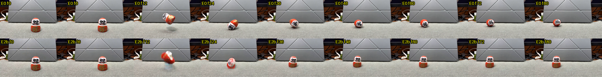
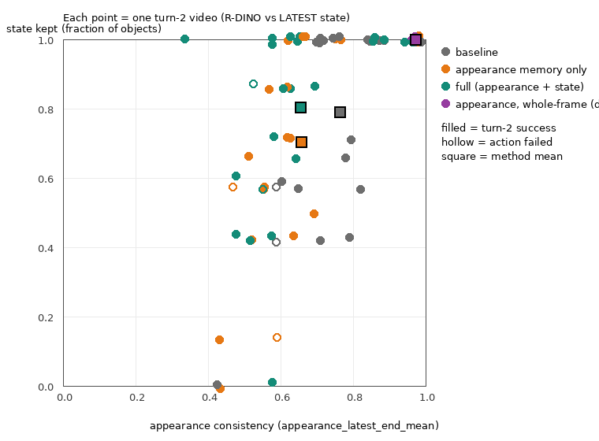
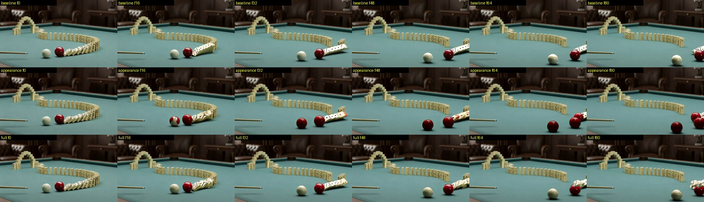
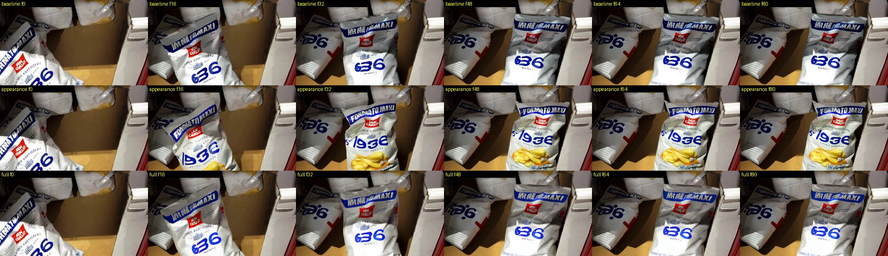
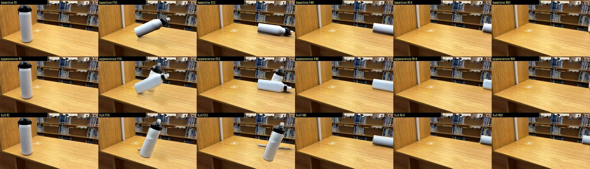
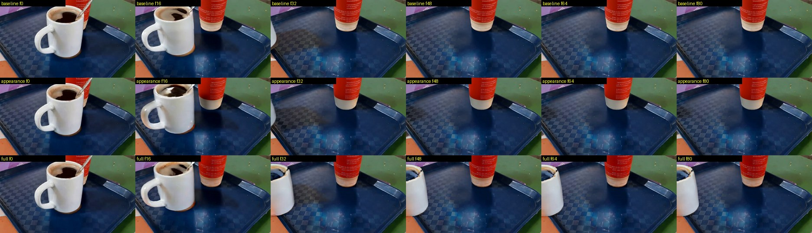

# 進度更新 2026-11-25：多回合 Goal Force 的物件狀態記憶

## 1. 研究問題與一句話結論
**問題：** 連續施力好幾回合時，影片模型會弄丟物件的狀態，例如倒下的東西變形、融成一塊、消失。如果加入「外觀記憶」（記住物件原本長什麼樣子），外觀能不能保住？狀態會不會反而倒退？

**一句話結論（初步觀察）：** 只加外觀記憶時，**外觀和狀態兩邊都變差**，最常見的是物件身分被換掉（白球被畫成紅球）。把外觀和狀態分開處理後，身分錯置消失，狀態略有改善，但外觀分數下降。也就是說，我們在外觀與狀態的 trade-off 上**換了一個位置**，還沒有讓兩邊同時變好。

## 研究動機：達摩的例子（為什麼要做外觀記憶）
Goal Force 推動物件時，**物件本身會變形**。實拍的達摩被推飛後，臉和花紋不見了，落地時變成一顆**沒有臉的紅色圓球**在地上滾。如果要做多回合互動，物件每推一次就變一次樣子，後面的回合就接不下去。這是我們想加入「外觀記憶」的原因。

我們先試了外觀修補：用 SAM2 追蹤達摩，再用 VACE 以第 0 格的達摩當參考圖重畫物件區域（E2b）。4 支影片的結果：

| 指標 | Goal Force 原始輸出 | 加外觀修補 |
|---|---|---|
| R-DINO（外觀相似度）↑ | 0.44 | **0.73** |
| 輪廓 IoU ↑ | 0.84 | **0.92** |
| 色差 ΔE ↓ | 10.2 | **7.1** |

外觀確實保住了：臉和花紋都在，也不再變成紅球。**但出現了新問題。** 下圖上排是原始輸出，達摩被推飛後在地上滾；下排是修補後，達摩**一直維持直立坐正**，滾動的動作不見了。參考圖把物件拉回了它原本的姿勢。

- 影片：[daruma_upleft_s1_E0_vs_E2b.mp4](team_update_assets/videos/daruma_upleft_s1_E0_vs_E2b.mp4)（臉被修回來）、[daruma_upleft_s2_E0_vs_E2b.mp4](team_update_assets/videos/daruma_upleft_s2_E0_vs_E2b.mp4)（滾動變成坐正）；左邊是 Goal Force，右邊是外觀修補。
- 4 支影片的完整對照：[daruma_compare.png](team_update_assets/daruma_compare.png)

**這就是這次實驗要回答的問題：** 外觀記憶能保住外觀，卻會讓狀態倒退。多回合時，倒下的骨牌會不會被拉回直立？能不能讓原圖只提供外觀，而位置和姿勢以最新狀態為準？

## 2. 我們做了什麼
- 定義一套共用的評估方法：**狀態保留**（物件有沒有消失、融合、被拉回原狀）、**外觀一致性**（R-DINO，同時和原始外觀、最新狀態比較）、**第 2 回合成功**（目標物件有沒有往指定方向移動，有明確的距離和角度門檻）。
- 骨牌場景：從 2 種第 1 回合結局出發，各用 2 種推法、3 個 seed，共 12 支 Goal Force 影片，每支再比較 3 種方法。
- 5 張實拍照片（洋芋片、咖啡、水壺、書架 ×2）各跑 2 回合。洋芋片多做一組「第 2 回合不施力」的對照組。
- 分支實驗：從同一個第 1 回合結局，換 2 種不同的推法。
- 3 種方法都是 **training-free**，也就是不重新訓練模型、只在推論後修補：
  - **baseline**：直接用 Goal Force 的輸出。
  - **只有外觀記憶**：用原始物件的裁切圖，以 VACE 重畫物件區域。
  - **完整方法**：外觀記憶加上狀態約束。位置和姿態以最新狀態為準，原圖只提供顏色。

## 3. 主要結果
24 支第 2 回合 Goal Force 影片 × 3 種方法。「狀態保留」是保留下來的物件比例。

| 場景 | seed 數 | 方法 | 狀態保留 ↑ | 外觀一致性（R-DINO，對最新狀態）↑ | 第 2 回合成功 |
|---|---|---|---|---|---|
| 骨牌 | 12 | baseline | 0.73 | **0.71** | 10/12 |
| | | 只有外觀記憶 | 0.58 | 0.57 | 10/12 |
| | | 完整方法 | **0.77** | 0.57 | 10/12 |
| 骨牌分支（C、D） | 2 | baseline | 1.00 | **0.86** | 2/2 |
| | | 只有外觀記憶 | 1.00 | 0.76 | 2/2 |
| | | 完整方法 | 0.86 | 0.66 | 2/2 |
| 洋芋片（施力） | 3 | baseline / 外觀 / 完整 | 1.00 / 1.00 / 1.00 | 0.86 / 0.73 / 0.86 | 3/3 / 3/3 / 3/3 |
| 洋芋片（不施力對照） | 3 | baseline / 外觀 / 完整 | 1.00 / 1.00 / 1.00 | 0.98 / 0.98 / 0.96 | 3/3 / 3/3 / 3/3（都留在原地） |
| 咖啡 | 1 | baseline / 外觀 / 完整 | 1.00 / 0.50 / 1.00 | 0.71 / 0.69 / 0.35 | 全部成功 |
| 水壺 | 1 | baseline / 外觀 / 完整 | 0.00 / 0.00 / 0.00 | 0.42 / 0.43 / 0.59 | 全部成功 |
| 書架抽書 | 1 | baseline / 外觀 / 完整 | 0.67 / 0.67 / 0.67 | 0.77 / 0.52 / 0.65 | 全部成功 |
| 書架推書 | 1 | baseline / 外觀 / 完整 | 0.60 / 0.20 / 0.60 | 0.60 / – / 0.48 | 全部成功 |
| **全部合計** | 24 | baseline | 0.79 | **0.76** | 22/24 |
| | | 只有外觀記憶 | 0.68 | 0.66 | 22/24 |
| | | 完整方法 | **0.80** | 0.66 | 22/24 |

**第 1 回合**（每張照片 1 個 seed）：依規則判定，5 張中有 4 張成功。
- 書架抽書：畫面上看是成功的，但往畫面深處的動作，2D 規則量不到，所以依規則判定失敗。
- 書架推書：依規則判定「成功」，其實是**鏡頭平移**造成的誤判；扣掉鏡頭運動後是失敗，也沒有任何一本書倒下。

**第 2 回合失敗的 2 支**：都是同一批骨牌 Goal Force 影片，所以是 Goal Force 本身沒推成功。修補方法不會改變動作有沒有成功。

## 4. 關鍵發現
**外觀與狀態的 trade-off。** 每個點是一支影片，方塊是各方法的平均。

- 「只有外觀記憶」落在 baseline 的**左下方**，兩邊都比較差：
  - 14 支撞球桌影片中，有 12 支的白球被畫成紅球（身分錯置）。
  - 水壺場景多出一個**直立的分身**，也就是原始姿勢被「複製」回來。
- 「完整方法」**沒有任何身分錯置**，狀態保留和 baseline 相近或略高，但外觀分數較低，因為 VACE 1.3B 重畫時會產生色斑和破碎。
- 骨牌被推時融成一整塊，在 baseline 12 支裡有 8 支，完整方法降到 6 支。這是**初步觀察**，差距不大。

**洋芋片診斷實驗：** 袋子回到原位，是施力造成的，還是記憶拉回去的？
- **有施力時**：同一個 Goal Force seed 下，3 種方法的袋子停在**同一個位置**（誤差 ±6 px），所以是施力造成的。
- **不施力時**：3 種方法 × 3 個 seed，加上「整個畫面都可重畫」的診斷版本，袋子**都沒有回去**（位移 ≤ 2 px）。
- 結論：在我們的流程裡，記憶**不會拉回位置**；它影響的是**姿勢和身分**（直立、換色、分身）。
- 單一物件時，外觀記憶有正面效果：洋芋片包裝上的「1936」字樣被修回來，baseline 則壞成「66」。

## 5. 代表案例
每張圖由上到下是 baseline、只有外觀記憶、完整方法；由左到右是第 0、16、32、48、64、80 格。

**最好的 2 個**
1. **骨牌 s0 推法 A seed 0**：完整方法讓倒下的骨牌維持一片片分開（f32–48），baseline 則壓成一整塊被推出畫面。
   
   影片：`outputs/multiturn/exp8/repair/s0_A_seed0/full.mp4`；baseline：`outputs/multiturn/dominos_turn2/step-3000_t2A_*seed_0.mp4`
2. **洋芋片（施力）seed 1**：3 種方法都把袋子推回去；只有外觀記憶把字樣修回原貌。
   
   影片：`outputs/multiturn/ph_chips/repair/chips_t2_seed1/{appearance,full}.mp4`

**最差的 2 個**
1. **水壺，只有外觀記憶**：出現一個直立的分身，原始姿勢被拉回來。
   
   影片：`outputs/multiturn/ph_bottle/repair/bottle_t2_seed0/appearance.mp4`
2. **咖啡，完整方法**：杯子應該滑出畫面，狀態約束卻在左邊留下一個**殘影杯子**。這是我們自己方法的失敗。
   
   影片：`outputs/multiturn/ph_coffee/repair/coffee_t2_seed0/full.mp4`

**可以直接看的並排影片**：在 `team_update_assets/videos/`，左到右依序是 baseline／只有外觀記憶／完整方法。原始影片太大，沒有放進 git。
| 影片 | 看什麼 |
|---|---|
| [dominoes_s0A_seed0.mp4](team_update_assets/videos/dominoes_s0A_seed0.mp4) | 骨牌融成長板；中間那欄白球變紅；右欄骨牌維持分開 |
| [chips_t2_seed1.mp4](team_update_assets/videos/chips_t2_seed1.mp4) | 洋芋片推回原位；中間那欄字樣被修回 |
| [bottle_t2.mp4](team_update_assets/videos/bottle_t2.mp4) | 中間那欄出現直立的水壺分身 |
| [coffee_t2.mp4](team_update_assets/videos/coffee_t2.mp4) | 右欄留下殘影杯子（完整方法的失敗） |
| [branch_C.mp4](team_update_assets/videos/branch_C.mp4) | 分支：沒碰到骨牌堆時，倒下的骨牌不會融合 |

## 6. 和相關研究的差異（簡短版）
- **WorldMem**（NeurIPS 2025）、**Context as Memory**（SIGGRAPH Asia 2025）、**VMem**（ICCV 2025）、**RELIC**（2025）：記憶都以**鏡頭視角**為索引，處理的是「鏡頭回到同一處時，場景還一樣嗎」，而且需要訓練。
- **WonderPlay**（ICCV 2025）、**PerpetualWonder**（CVPR 2026）、**RealWonder**（2026）：把狀態放在**明確的 3D 或物理模擬**裡。
- **我們的切入點**：以**物件**為單位、2D、training-free 的記憶，專門看**施力互動之後**外觀和狀態衝突時會發生什麼。

以上定位只依據論文摘要，細節請見 overnight 報告 §8，表格中標「待確認」的部分還要再查。

## 7. 目前的限制
- **樣本少**：骨牌有 12 支，照片大多只有 1 個 seed（洋芋片 3 個）。以上都是初步觀察。
- **評估規則的盲點**：
  - 往畫面深處的動作（保齡球、書架抽書）2D 規則量不到。
  - 鏡頭平移會造成誤判（書架推書）。
  - 骨牌融成一塊時，SAM2 的 mask 看起來仍然正常，要靠外觀分數和人工檢查才看得出來。
- **畫面中有手**：模型把手當成場景內容。水壺場景的手沒有跟著動，而是自己離開了。
- **training-free 的限制**：
  - 只能重畫 Goal Force 已經生成的內容，無法修正錯誤的動態。
  - 只追蹤了 4 支倒下的骨牌，實際倒下的約 8–10 支。
  - VACE 1.3B 會造成色偏和破碎。
- **目視檢查不是盲評**：由我自己評，評分時知道是哪個方法。

## 8. 下一步與需要幫忙的事
- **人工盲評（需要 2–3 位組員）**：`outputs/multiturn/blind/` 有 75 張沒有標示方法的拼圖，請就狀態、外觀、動作各給 1–5 分，也請留意文字是否清楚。對照表在 `_key_DO_NOT_SHOW_RATERS.jsonl`，請不要打開。
- **重拍照片（需要 1 位組員）**：橫拍、畫面中不要有手、一排同類物件立著，旁邊留出倒下的空間（例如一排立著的書或積木）。咖啡場景請讓兩個杯子都完整入鏡。
- **方法方向（需要討論）**：
  - demo 版：記憶改當「驗收器」，偵測到壞的回合就換 seed 重生成。
  - 研究版：把狀態約束放進生成過程裡，而不是生成後才修補。
- **demo 介面（需要 1 位負責人）**：分支實驗證明可以「回到第 1 回合、改推別的物件」，介面可以開始規劃。

技術細節和所有數字請見 `reports/overnight_2026-11-25.md`。
