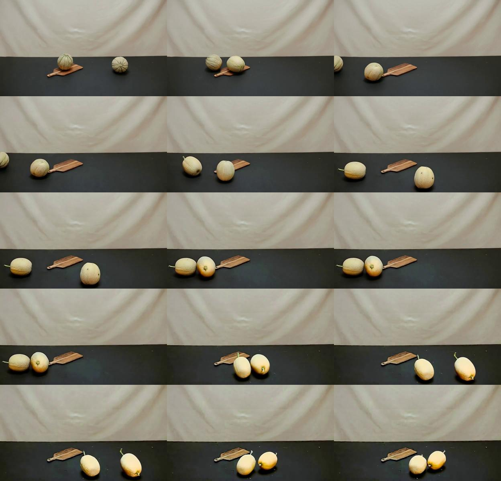

# 影片總覽（給組員看）

點連結會用瀏覽器直接播放。全部是 Goal Force（Wan2.2-I2V-A14B + ControlNet）在**原論文範例照片**上生成。
每支影片的 prompt、施力點、角度、力道見 [`paper_review_prompts.md`](paper_review_prompts.md)；研究背景與進度見 [`handoff_2026-11-27.md`](handoff_2026-11-27.md)。

檔名開頭字母 = 建議觀看順序：**A** 5 回合 → **B** 新版兩回合（照論文的因果寫法）→ **C** 互撞版兩回合 → **D** 第一版兩回合 → **E** 骨牌 11/25 版。`lowforce` = 第 1 回合鏡頭固定、力道 150（原論文 350）；`seed` = 隨機種子。

## A. 實驗 A：同一張照片連續 5 回合互撞

左 = 原照片，右 = 第 1→5 回合連續播放。

| 場景 | 影片 | 看什麼 |
|---|---|---|
| 哈密瓜 | [A_5turns_cantaloupes.mp4](https://github.com/Linda62345/CVPDL-goal-force-reproduce/blob/appearance-multiturn/reports/videos/A_5turns_cantaloupes.mp4?raw=true) | **外觀漂移**：物理大致合理，但第 3 回合起瓜變橢圓、網紋消失、長蒂頭；被推的瓜外觀分數 0.63→0.05 |
| 西洋棋（狗爪） | [A_5turns_chess_dogpaw.mp4](https://github.com/Linda62345/CVPDL-goal-force-reproduce/blob/appearance-multiturn/reports/videos/A_5turns_chess_dogpaw.mp4?raw=true) | **物體消失／出現**：黑棋第 3 回合起消失或被推出棋盤，第 5 回合又冒出；棋盤和狗爪穩定 |

哈密瓜：每回合開頭／中間／結尾（一列一回合）

西洋棋（狗爪）：每回合開頭／中間／結尾（一列一回合）

## B. 新版兩回合：照論文的因果寫法（11/27）

第 2 回合用 goal 模式，文字寫明誰造成動作（手、爪子、球桿、另一顆球）。左 = 原照片，中 = baseline（直接拿上一回合最後一幀生成），右 = LoRA 外觀修補；先播第 1 回合（中、右相同）再播第 2 回合。

| 場景 | seed | 影片 | 看什麼 |
|---|---|---|---|
| 哈密瓜 | 0 | [B_2turns_causal_lowforce_cantaloupes_seed0.mp4](https://github.com/Linda62345/CVPDL-goal-force-reproduce/blob/appearance-multiturn/reports/videos/B_2turns_causal_lowforce_cantaloupes_seed0.mp4?raw=true) | 右瓜撞回左瓜、左瓜被撞往左：**因果正確**；但瓜已開始變黃、變橢圓 |
| 鐘擺 | 0 | [B_2turns_causal_lowforce_pendulum_seed0.mp4](https://github.com/Linda62345/CVPDL-goal-force-reproduce/blob/appearance-multiturn/reports/videos/B_2turns_causal_lowforce_pendulum_seed0.mp4?raw=true) | 第 1 回合撞倒方塊；第 2 回合方塊在最右邊，**鐘擺搆不到**，方塊沒動 |

## C. 互撞版兩回合（direct 模式，力道 100–150）

第 2 回合用看不見的力直接推物體去撞另一個（或再推一次）。左 = 原照片，中 = baseline（直接拿上一回合最後一幀生成），右 = LoRA 外觀修補；先播第 1 回合（中、右相同）再播第 2 回合。

| 場景 | seed | 影片 | 看什麼 |
|---|---|---|---|
| 紅球（貓爪） | 1 | [C_2turns_directpush_ball_catpaw_seed1.mp4](https://github.com/Linda62345/CVPDL-goal-force-reproduce/blob/appearance-multiturn/reports/videos/C_2turns_directpush_ball_catpaw_seed1.mp4?raw=true) |  |
| 藍球（狗爪） | 1 | [C_2turns_directpush_ball_dogpaw_seed1.mp4](https://github.com/Linda62345/CVPDL-goal-force-reproduce/blob/appearance-multiturn/reports/videos/C_2turns_directpush_ball_dogpaw_seed1.mp4?raw=true) |  |
| 燈泡（手） | 1 | [C_2turns_directpush_bulbs_hand_seed1.mp4](https://github.com/Linda62345/CVPDL-goal-force-reproduce/blob/appearance-multiturn/reports/videos/C_2turns_directpush_bulbs_hand_seed1.mp4?raw=true) |  |
| 哈密瓜 | 1 | [C_2turns_directpush_cantaloupes_seed1.mp4](https://github.com/Linda62345/CVPDL-goal-force-reproduce/blob/appearance-multiturn/reports/videos/C_2turns_directpush_cantaloupes_seed1.mp4?raw=true) |  |
| 西洋棋（狗爪） | 1 | [C_2turns_directpush_chess_dogpaw_seed1.mp4](https://github.com/Linda62345/CVPDL-goal-force-reproduce/blob/appearance-multiturn/reports/videos/C_2turns_directpush_chess_dogpaw_seed1.mp4?raw=true) |  |
| 鐘擺 | 1 | [C_2turns_directpush_pendulum_seed1.mp4](https://github.com/Linda62345/CVPDL-goal-force-reproduce/blob/appearance-multiturn/reports/videos/C_2turns_directpush_pendulum_seed1.mp4?raw=true) |  |
| 足球（腳） | 1 | [C_2turns_directpush_soccer_kick_seed1.mp4](https://github.com/Linda62345/CVPDL-goal-force-reproduce/blob/appearance-multiturn/reports/videos/C_2turns_directpush_soccer_kick_seed1.mp4?raw=true) |  |
| 網球 | 1 | [C_2turns_directpush_tennis_seed1.mp4](https://github.com/Linda62345/CVPDL-goal-force-reproduce/blob/appearance-multiturn/reports/videos/C_2turns_directpush_tennis_seed1.mp4?raw=true) |  |

## D. 第一版兩回合（11/26，direct 模式，力道 200）

第 2 回合固定方向推一次。左 = 原照片，中 = baseline（直接拿上一回合最後一幀生成），右 = LoRA 外觀修補；先播第 1 回合（中、右相同）再播第 2 回合。

| 場景 | seed | 影片 | 看什麼 |
|---|---|---|---|
| 紅球（貓爪） | 0 | [D_2turns_firstdesign_ball_catpaw_seed0.mp4](https://github.com/Linda62345/CVPDL-goal-force-reproduce/blob/appearance-multiturn/reports/videos/D_2turns_firstdesign_ball_catpaw_seed0.mp4?raw=true) |  |
| 藍球（狗爪） | 0 | [D_2turns_firstdesign_ball_dogpaw_seed0.mp4](https://github.com/Linda62345/CVPDL-goal-force-reproduce/blob/appearance-multiturn/reports/videos/D_2turns_firstdesign_ball_dogpaw_seed0.mp4?raw=true) |  |
| 燈泡（手） | 0 | [D_2turns_firstdesign_bulbs_hand_seed0_INVALID.mp4](https://github.com/Linda62345/CVPDL-goal-force-reproduce/blob/appearance-multiturn/reports/videos/D_2turns_firstdesign_bulbs_hand_seed0_INVALID.mp4?raw=true) | **作廢**：追蹤把兩個燈泡當成同一個，力推在錯的燈泡上 |
| 哈密瓜 | 0 | [D_2turns_firstdesign_cantaloupes_seed0.mp4](https://github.com/Linda62345/CVPDL-goal-force-reproduce/blob/appearance-multiturn/reports/videos/D_2turns_firstdesign_cantaloupes_seed0.mp4?raw=true) |  |
| 哈密瓜 | 1 | [D_2turns_firstdesign_cantaloupes_seed1.mp4](https://github.com/Linda62345/CVPDL-goal-force-reproduce/blob/appearance-multiturn/reports/videos/D_2turns_firstdesign_cantaloupes_seed1.mp4?raw=true) |  |
| 西洋棋（狗爪） | 0 | [D_2turns_firstdesign_chess_dogpaw_seed0.mp4](https://github.com/Linda62345/CVPDL-goal-force-reproduce/blob/appearance-multiturn/reports/videos/D_2turns_firstdesign_chess_dogpaw_seed0.mp4?raw=true) |  |
| 鐘擺 | 0 | [D_2turns_firstdesign_pendulum_seed0.mp4](https://github.com/Linda62345/CVPDL-goal-force-reproduce/blob/appearance-multiturn/reports/videos/D_2turns_firstdesign_pendulum_seed0.mp4?raw=true) |  |
| 足球（腳） | 0 | [D_2turns_firstdesign_soccer_kick_seed0.mp4](https://github.com/Linda62345/CVPDL-goal-force-reproduce/blob/appearance-multiturn/reports/videos/D_2turns_firstdesign_soccer_kick_seed0.mp4?raw=true) |  |
| 網球 | 1 | [D_2turns_firstdesign_tennis_seed1.mp4](https://github.com/Linda62345/CVPDL-goal-force-reproduce/blob/appearance-multiturn/reports/videos/D_2turns_firstdesign_tennis_seed1.mp4?raw=true) |  |
| 玩具車（手） | 0 | [D_2turns_firstdesign_toycar_hand_seed0.mp4](https://github.com/Linda62345/CVPDL-goal-force-reproduce/blob/appearance-multiturn/reports/videos/D_2turns_firstdesign_toycar_hand_seed0.mp4?raw=true) |  |

## E. 骨牌 11/25 版（第 2 回合四種設計）

`t1seed` = 第 1 回合 seed，`t2seed` = 第 2 回合 seed。A = 白球再撞一次；B = goal 指定倒下的骨牌；C = 紅球撞回白球；D = 推後排站著的骨牌。左 = 原照片，中 = baseline（直接拿上一回合最後一幀生成），右 = LoRA 外觀修補；先播第 1 回合（中、右相同）再播第 2 回合。

| 影片 |
|---|
| [E_dominoes_1125_t1seed0_A_white_ball_again_t2seed0.mp4](https://github.com/Linda62345/CVPDL-goal-force-reproduce/blob/appearance-multiturn/reports/videos/E_dominoes_1125_t1seed0_A_white_ball_again_t2seed0.mp4?raw=true) |
| [E_dominoes_1125_t1seed0_A_white_ball_again_t2seed1.mp4](https://github.com/Linda62345/CVPDL-goal-force-reproduce/blob/appearance-multiturn/reports/videos/E_dominoes_1125_t1seed0_A_white_ball_again_t2seed1.mp4?raw=true) |
| [E_dominoes_1125_t1seed0_A_white_ball_again_t2seed2.mp4](https://github.com/Linda62345/CVPDL-goal-force-reproduce/blob/appearance-multiturn/reports/videos/E_dominoes_1125_t1seed0_A_white_ball_again_t2seed2.mp4?raw=true) |
| [E_dominoes_1125_t1seed0_B_goal_on_fallen_domino_t2seed0.mp4](https://github.com/Linda62345/CVPDL-goal-force-reproduce/blob/appearance-multiturn/reports/videos/E_dominoes_1125_t1seed0_B_goal_on_fallen_domino_t2seed0.mp4?raw=true) |
| [E_dominoes_1125_t1seed0_B_goal_on_fallen_domino_t2seed1.mp4](https://github.com/Linda62345/CVPDL-goal-force-reproduce/blob/appearance-multiturn/reports/videos/E_dominoes_1125_t1seed0_B_goal_on_fallen_domino_t2seed1.mp4?raw=true) |
| [E_dominoes_1125_t1seed0_B_goal_on_fallen_domino_t2seed2.mp4](https://github.com/Linda62345/CVPDL-goal-force-reproduce/blob/appearance-multiturn/reports/videos/E_dominoes_1125_t1seed0_B_goal_on_fallen_domino_t2seed2.mp4?raw=true) |
| [E_dominoes_1125_t1seed0_C_red_ball_back_t2seed0.mp4](https://github.com/Linda62345/CVPDL-goal-force-reproduce/blob/appearance-multiturn/reports/videos/E_dominoes_1125_t1seed0_C_red_ball_back_t2seed0.mp4?raw=true) |
| [E_dominoes_1125_t1seed0_D_push_backrow_domino_t2seed0.mp4](https://github.com/Linda62345/CVPDL-goal-force-reproduce/blob/appearance-multiturn/reports/videos/E_dominoes_1125_t1seed0_D_push_backrow_domino_t2seed0.mp4?raw=true) |
| [E_dominoes_1125_t1seed1_A_white_ball_again_t2seed0.mp4](https://github.com/Linda62345/CVPDL-goal-force-reproduce/blob/appearance-multiturn/reports/videos/E_dominoes_1125_t1seed1_A_white_ball_again_t2seed0.mp4?raw=true) |
| [E_dominoes_1125_t1seed1_A_white_ball_again_t2seed1.mp4](https://github.com/Linda62345/CVPDL-goal-force-reproduce/blob/appearance-multiturn/reports/videos/E_dominoes_1125_t1seed1_A_white_ball_again_t2seed1.mp4?raw=true) |
| [E_dominoes_1125_t1seed1_A_white_ball_again_t2seed2.mp4](https://github.com/Linda62345/CVPDL-goal-force-reproduce/blob/appearance-multiturn/reports/videos/E_dominoes_1125_t1seed1_A_white_ball_again_t2seed2.mp4?raw=true) |
| [E_dominoes_1125_t1seed1_B_goal_on_fallen_domino_t2seed0.mp4](https://github.com/Linda62345/CVPDL-goal-force-reproduce/blob/appearance-multiturn/reports/videos/E_dominoes_1125_t1seed1_B_goal_on_fallen_domino_t2seed0.mp4?raw=true) |
| [E_dominoes_1125_t1seed1_B_goal_on_fallen_domino_t2seed1.mp4](https://github.com/Linda62345/CVPDL-goal-force-reproduce/blob/appearance-multiturn/reports/videos/E_dominoes_1125_t1seed1_B_goal_on_fallen_domino_t2seed1.mp4?raw=true) |
| [E_dominoes_1125_t1seed1_B_goal_on_fallen_domino_t2seed2.mp4](https://github.com/Linda62345/CVPDL-goal-force-reproduce/blob/appearance-multiturn/reports/videos/E_dominoes_1125_t1seed1_B_goal_on_fallen_domino_t2seed2.mp4?raw=true) |
