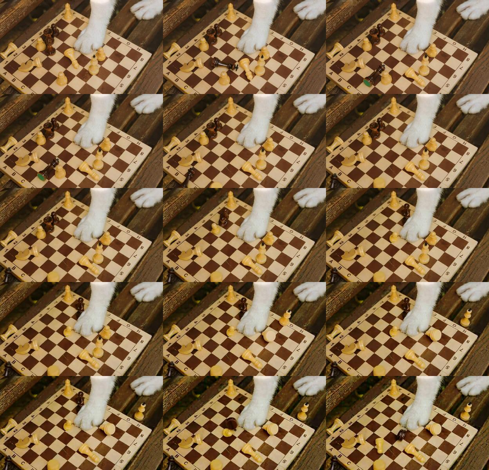

# 影片總覽（給組員看）

點連結會用瀏覽器直接播放（`?raw=true`）。所有影片都是 Goal Force（Wan2.2-I2V-A14B + ControlNet）在**原論文範例照片**上生成。
每支影片的 prompt、施力點、角度、力道見 [`paper_review_prompts.md`](paper_review_prompts.md)；研究背景與進度見 [`handoff_2026-11-27.md`](handoff_2026-11-27.md)。

## 1. 最重要：實驗 A，同一張照片連續 5 回合互撞

格式：左 = 原照片，右 = 第 1→5 回合連續播放。

| 場景 | 影片 | 看什麼 |
|---|---|---|
| 哈密瓜（力道 150） | [chain_cantaloupes.mp4](https://github.com/Linda62345/CVPDL-goal-force-reproduce/blob/appearance-multiturn/reports/videos/chain_cantaloupes.mp4?raw=true) | **外觀漂移**：第 3 回合起瓜變橢圓、網紋消失、長蒂頭；被推的瓜外觀分數 0.63→0.05。物理運動本身大致合理 |
| 西洋棋（力道 100） | [chain_paw_tool1.mp4](https://github.com/Linda62345/CVPDL-goal-force-reproduce/blob/appearance-multiturn/reports/videos/chain_paw_tool1.mp4?raw=true) | **物體消失／出現**：黑棋第 3 回合起消失或被推出棋盤，第 5 回合又冒出；棋盤與狗爪穩定 |

每回合開頭／中間／結尾畫面（一列一回合）：

哈密瓜：

西洋棋：

## 2. 兩回合（第 1 回合照原論文，第 2 回合我們設計）

格式：左 = 原照片，中 = baseline（直接拿上一回合最後一幀生成），右 = LoRA 外觀修補。先播第 1 回合（中、右相同），再播第 2 回合。

| 場景 | 影片 |
|---|---|
| 燈泡 seed 0 | [paper_bulb_tool_s0.mp4](https://github.com/Linda62345/CVPDL-goal-force-reproduce/blob/appearance-multiturn/reports/videos/paper_bulb_tool_s0.mp4?raw=true) |
| 哈密瓜 seed 0 | [paper_cantaloupes_s0.mp4](https://github.com/Linda62345/CVPDL-goal-force-reproduce/blob/appearance-multiturn/reports/videos/paper_cantaloupes_s0.mp4?raw=true) |
| 哈密瓜 seed 1 | [paper_cantaloupes_s1.mp4](https://github.com/Linda62345/CVPDL-goal-force-reproduce/blob/appearance-multiturn/reports/videos/paper_cantaloupes_s1.mp4?raw=true) |
| 西洋棋（狗） seed 0 | [paper_paw_tool1_s0.mp4](https://github.com/Linda62345/CVPDL-goal-force-reproduce/blob/appearance-multiturn/reports/videos/paper_paw_tool1_s0.mp4?raw=true) |
| 藍球（狗） seed 0 | [paper_paw_tool2_s0.mp4](https://github.com/Linda62345/CVPDL-goal-force-reproduce/blob/appearance-multiturn/reports/videos/paper_paw_tool2_s0.mp4?raw=true) |
| 紅球（貓） seed 0 | [paper_paw_tool3_s0.mp4](https://github.com/Linda62345/CVPDL-goal-force-reproduce/blob/appearance-multiturn/reports/videos/paper_paw_tool3_s0.mp4?raw=true) |
| 鐘擺 seed 0 | [paper_pendulum_s0.mp4](https://github.com/Linda62345/CVPDL-goal-force-reproduce/blob/appearance-multiturn/reports/videos/paper_pendulum_s0.mp4?raw=true) |
| 足球 seed 0 | [paper_soccer_tool_s0.mp4](https://github.com/Linda62345/CVPDL-goal-force-reproduce/blob/appearance-multiturn/reports/videos/paper_soccer_tool_s0.mp4?raw=true) |
| 網球 seed 1 | [paper_tennis_s1.mp4](https://github.com/Linda62345/CVPDL-goal-force-reproduce/blob/appearance-multiturn/reports/videos/paper_tennis_s1.mp4?raw=true) |
| 玩具車 seed 0 | [paper_toycar_s0.mp4](https://github.com/Linda62345/CVPDL-goal-force-reproduce/blob/appearance-multiturn/reports/videos/paper_toycar_s0.mp4?raw=true) |

第 2 回合在這一版是 direct 模式、力道 200；燈泡 seed 0 因追蹤錯誤推錯了燈泡，**作廢**。

## 3. 骨牌（11/25 版，第 2 回合 A/B/C/D 四種設計）

檔名：`<第1回合seed>_<版本>_seed<第2回合seed>`。A＝白球再撞一次；B＝goal 指定倒下的骨牌；C＝紅球撞回白球；D＝推後排站著的骨牌。

| 版本 | 影片 |
|---|---|
| s0_A_seed0 | [paper_ballthendominos_s0_A_seed0.mp4](https://github.com/Linda62345/CVPDL-goal-force-reproduce/blob/appearance-multiturn/reports/videos/paper_ballthendominos_s0_A_seed0.mp4?raw=true) |
| s0_A_seed1 | [paper_ballthendominos_s0_A_seed1.mp4](https://github.com/Linda62345/CVPDL-goal-force-reproduce/blob/appearance-multiturn/reports/videos/paper_ballthendominos_s0_A_seed1.mp4?raw=true) |
| s0_A_seed2 | [paper_ballthendominos_s0_A_seed2.mp4](https://github.com/Linda62345/CVPDL-goal-force-reproduce/blob/appearance-multiturn/reports/videos/paper_ballthendominos_s0_A_seed2.mp4?raw=true) |
| s0_B_seed0 | [paper_ballthendominos_s0_B_seed0.mp4](https://github.com/Linda62345/CVPDL-goal-force-reproduce/blob/appearance-multiturn/reports/videos/paper_ballthendominos_s0_B_seed0.mp4?raw=true) |
| s0_B_seed1 | [paper_ballthendominos_s0_B_seed1.mp4](https://github.com/Linda62345/CVPDL-goal-force-reproduce/blob/appearance-multiturn/reports/videos/paper_ballthendominos_s0_B_seed1.mp4?raw=true) |
| s0_B_seed2 | [paper_ballthendominos_s0_B_seed2.mp4](https://github.com/Linda62345/CVPDL-goal-force-reproduce/blob/appearance-multiturn/reports/videos/paper_ballthendominos_s0_B_seed2.mp4?raw=true) |
| s0_C_seed0 | [paper_ballthendominos_s0_C_seed0.mp4](https://github.com/Linda62345/CVPDL-goal-force-reproduce/blob/appearance-multiturn/reports/videos/paper_ballthendominos_s0_C_seed0.mp4?raw=true) |
| s0_D_seed0 | [paper_ballthendominos_s0_D_seed0.mp4](https://github.com/Linda62345/CVPDL-goal-force-reproduce/blob/appearance-multiturn/reports/videos/paper_ballthendominos_s0_D_seed0.mp4?raw=true) |
| s1_A_seed0 | [paper_ballthendominos_s1_A_seed0.mp4](https://github.com/Linda62345/CVPDL-goal-force-reproduce/blob/appearance-multiturn/reports/videos/paper_ballthendominos_s1_A_seed0.mp4?raw=true) |
| s1_A_seed1 | [paper_ballthendominos_s1_A_seed1.mp4](https://github.com/Linda62345/CVPDL-goal-force-reproduce/blob/appearance-multiturn/reports/videos/paper_ballthendominos_s1_A_seed1.mp4?raw=true) |
| s1_A_seed2 | [paper_ballthendominos_s1_A_seed2.mp4](https://github.com/Linda62345/CVPDL-goal-force-reproduce/blob/appearance-multiturn/reports/videos/paper_ballthendominos_s1_A_seed2.mp4?raw=true) |
| s1_B_seed0 | [paper_ballthendominos_s1_B_seed0.mp4](https://github.com/Linda62345/CVPDL-goal-force-reproduce/blob/appearance-multiturn/reports/videos/paper_ballthendominos_s1_B_seed0.mp4?raw=true) |
| s1_B_seed1 | [paper_ballthendominos_s1_B_seed1.mp4](https://github.com/Linda62345/CVPDL-goal-force-reproduce/blob/appearance-multiturn/reports/videos/paper_ballthendominos_s1_B_seed1.mp4?raw=true) |
| s1_B_seed2 | [paper_ballthendominos_s1_B_seed2.mp4](https://github.com/Linda62345/CVPDL-goal-force-reproduce/blob/appearance-multiturn/reports/videos/paper_ballthendominos_s1_B_seed2.mp4?raw=true) |

## 4. 新版兩回合：照論文的因果寫法（`t2c_v2_*`，11/27）

第 1 回合：原論文 prompt + The camera is static.，力道 150。第 2 回合：goal 模式，文字寫明誰造成動作。格式同第 2 節。

| 場景 | 影片 | 看什麼 |
|---|---|---|
| 哈密瓜 | [t2c_v2_cantaloupes_s0.mp4](https://github.com/Linda62345/CVPDL-goal-force-reproduce/blob/appearance-multiturn/reports/videos/t2c_v2_cantaloupes_s0.mp4?raw=true) | 右瓜撞回左瓜，左瓜被撞往左：**因果正確**；但瓜已開始變黃、變橢圓 |
| 鐘擺 | [t2c_v2_pendulum_s0.mp4](https://github.com/Linda62345/CVPDL-goal-force-reproduce/blob/appearance-multiturn/reports/videos/t2c_v2_pendulum_s0.mp4?raw=true) | 第 1 回合撞倒方塊；第 2 回合方塊在桌子最右邊，**鐘擺搆不到**，方塊沒動（模型沒有硬讓它動） |

其他場景今晚跑完後補上。

## 5. seed 1 互撞版（`t2b_*`，direct 模式，力道 100–150；舊寫法，可和第 4 節對照）

| 場景 | 影片 |
|---|---|
| 燈泡 | [t2b_bulb_tool_s1.mp4](https://github.com/Linda62345/CVPDL-goal-force-reproduce/blob/appearance-multiturn/reports/videos/t2b_bulb_tool_s1.mp4?raw=true) |
| 哈密瓜 | [t2b_cantaloupes_s1.mp4](https://github.com/Linda62345/CVPDL-goal-force-reproduce/blob/appearance-multiturn/reports/videos/t2b_cantaloupes_s1.mp4?raw=true) |
| 西洋棋（狗） | [t2b_paw_tool1_s1.mp4](https://github.com/Linda62345/CVPDL-goal-force-reproduce/blob/appearance-multiturn/reports/videos/t2b_paw_tool1_s1.mp4?raw=true) |
| 藍球（狗） | [t2b_paw_tool2_s1.mp4](https://github.com/Linda62345/CVPDL-goal-force-reproduce/blob/appearance-multiturn/reports/videos/t2b_paw_tool2_s1.mp4?raw=true) |
| 紅球（貓） | [t2b_paw_tool3_s1.mp4](https://github.com/Linda62345/CVPDL-goal-force-reproduce/blob/appearance-multiturn/reports/videos/t2b_paw_tool3_s1.mp4?raw=true) |
| 鐘擺 | [t2b_pendulum_s1.mp4](https://github.com/Linda62345/CVPDL-goal-force-reproduce/blob/appearance-multiturn/reports/videos/t2b_pendulum_s1.mp4?raw=true) |
| 足球 | [t2b_soccer_tool_s1.mp4](https://github.com/Linda62345/CVPDL-goal-force-reproduce/blob/appearance-multiturn/reports/videos/t2b_soccer_tool_s1.mp4?raw=true) |
| 網球 | [t2b_tennis_s1.mp4](https://github.com/Linda62345/CVPDL-goal-force-reproduce/blob/appearance-multiturn/reports/videos/t2b_tennis_s1.mp4?raw=true) |

## 之後會補上

- 其餘 `t2c_v2_*`：今晚跑的新版，第 1 回合鏡頭固定、力道 150，第 2 回合照論文用 goal 模式並在文字寫明原因（手、爪子、球桿、另一顆球），含骨牌「再推倒其他骨牌」
